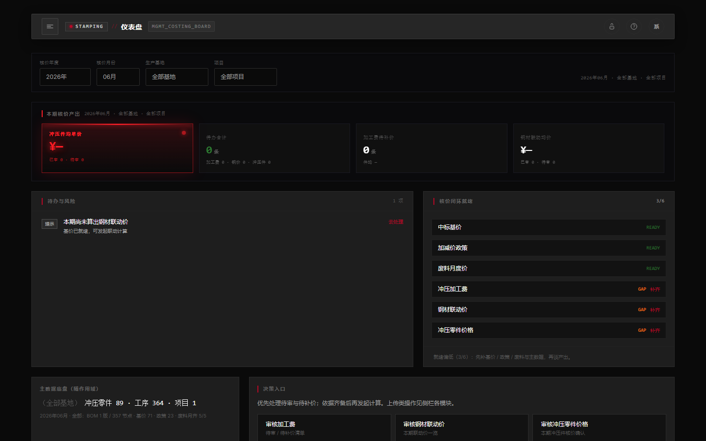
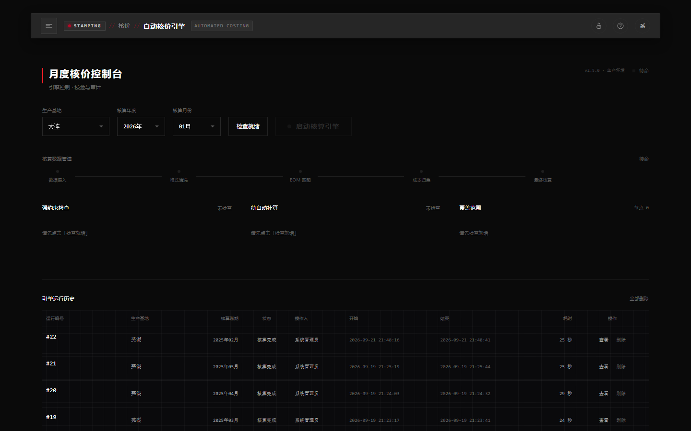
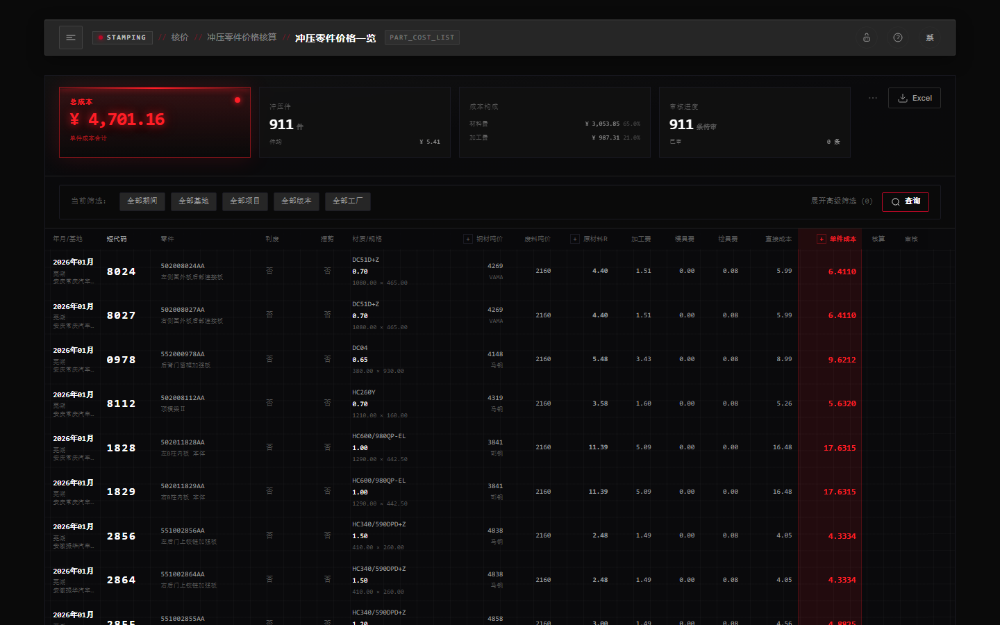
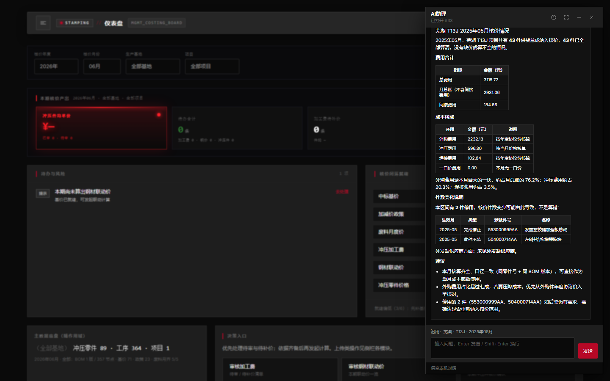
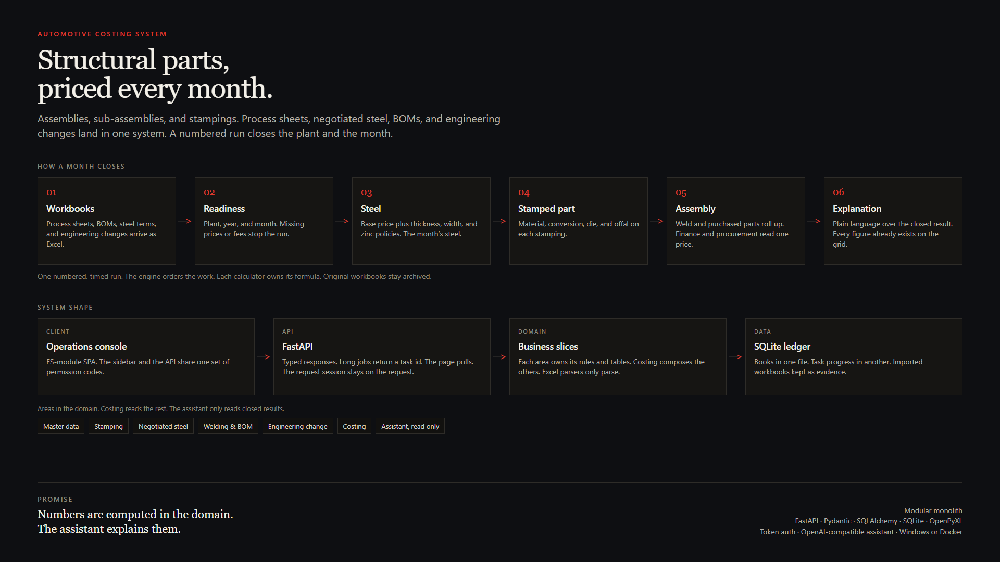

**English** · [简体中文](README.zh-CN.md)

# Enterprise Automotive Structural Parts Costing Platform

> A deterministic, audit-ready platform for monthly cost closing. Steel, stamped parts, and assemblies are priced in the domain. The assistant only explains figures that close already produced.

---

### Proven production backing

Actively deployed for enterprise manufacturers:

- **Hailian Jinhui (海联金汇)** — Publicly listed automotive component manufacturer (SZSE: 002537).
- **Puwei (普威)** — Automotive and industrial parts supplier.
- **Xiangtailier (祥泰利尔)** — Precision manufacturing and components supplier.

---

## The problem

Cost engineers and buyers price assemblies, sub-assemblies, and stampings from separate Excel workbooks: process sheets, negotiated steel terms, BOMs, and engineering changes. Versions drift, formulas break, and a missing fee delays the monthly close.

This platform is the single place those workbooks land. It archives the files, refuses to run until the plant and month are ready, and prices steel, stamped parts, and assemblies in one numbered job. Finance and procurement read the same figures.

---

## How a month closes

```text
01 Workbooks → 02 Readiness → 03 Steel → 04 Stamped part → 05 Assembly → 06 Explanation
   Excel in      plant + month    mill price    material + die   weld + buy      cites the grid
                 must be ready                  + offal          one price
```

1. **Workbooks.** Process sheets, BOMs, negotiated steel terms, and engineering changes come in as Excel. The original files stay archived.
2. **Readiness.** The scope is a plant, a year, and a month. Missing prices or fees stop the run before any figure is written.
3. **Steel.** Base price plus thickness, width, and zinc policies become that month’s steel price.
4. **Stamped part.** Material, conversion, die, and offal on each stamping.
5. **Assembly.** Weld and purchased parts roll up. Finance and procurement read one price.
6. **Explanation.** Plain language over the closed result. Every cited figure already exists on the grid.

One numbered, timed run. The engine orders the work. Each calculator owns its formula.

<p>
  
  
</p>
<p>
  
  
</p>

---

## System shape

```text
Operations console          FastAPI                      SQLite
ES-module SPA        ───►   modular monolith      ───►   books + task progress
                     ◄───   permission on every route    workbooks archived
                                    │
                                    ▼
                             Assistant, read only
                             cites the closed grid
```

Domain areas, in dependency order. Costing reads the others. Those areas do not read costing. The assistant reads results and is not on the pricing path.

`Master data` · `Stamping` · `Negotiated steel` · `Welding & BOM` · `Engineering change` · `Costing`

- **Modular monolith.** Each business area owns its API, rules, and tables. Calls run Router → Service → Repository → Database. Excel parsers only parse.
- **Decimal money.** Prices stay in `Decimal` through the domain. JSON formatting happens at the edge, not in a router.
- **Private deployment.** Windows server or Docker, on the customer’s machine. Books, task progress, and archived workbooks stay there. The assistant is optional: with no API key the close still finishes from the domain rules. Screens and downloads share one permission list.
- **Polled long jobs.** Upload and calculate return a task id. The request session never enters the worker.
- **The assistant does not price.** Numbers are produced by the costing library. The model cites those rows.



Architecture walkthrough: [docs/architecture.md](docs/architecture.md).

---

## Stack

| | |
|--|--|
| API | Python 3.12+, FastAPI, Pydantic v2, SQLAlchemy 2 |
| Data | SQLite (`data/stamping_costing.db`, `data/auxiliary.db` for sessions and tasks) |
| Workbooks | OpenPyXL, xlrd, Pillow for embedded sketches |
| UI | ES-module SPA in `static/`. Hash router, checked-in Tailwind, no bundler |
| Auth | Token (`X-Token` or Bearer) and permission codes |
| Assistant | OpenAI-compatible chat API. Empty `LLM_API_KEY` falls back to a rule-based summary |
| Ship | Windows one-click install, or Docker via `deploy.sh` |

License **MIT**.

---

## Author

Designed and built as a solutions architect and full-stack engineer: domain model, costing engine, API, and operations console.

- GitHub: [@pulinzhang](https://github.com/pulinzhang)
- Repository: [structure-costing-platform](https://github.com/pulinzhang/structure-costing-platform)

---

## Run locally

```powershell
python -m venv .venv
.\.venv\Scripts\Activate.ps1
pip install -r requirements.txt
pip install -r requirements-dev.txt
copy .env.example .env
pre-commit install
python main.py
```

macOS and Linux: `source .venv/bin/activate`, then `cp .env.example .env`.

| | |
|--|--|
| App | http://localhost:8000/app |
| Login | http://localhost:8000/login |
| OpenAPI | http://localhost:8000/docs |

First boot with an empty user table creates **`admin` / `admin123`**. Change that password before any shared deploy.

| Variable | Role | Default |
|----------|------|---------|
| `APP_ENV` | `development` / `production` / `test` | `development` |
| `DATABASE_URL` | Main library | `sqlite:///./data/stamping_costing.db` |
| `PASSWORD_SALT` | Password digest salt | built-in; override in production |
| `LLM_API_KEY` | Assistant key | empty → rule-based summary |
| `LLM_MODEL` / `LLM_BASE_URL` | Model and endpoint | `deepseek-chat` / DeepSeek |

Deploy notes: [Windows production install](docs/deploy-windows-production.md) and `bash deploy.sh` on a cloud host.

| | |
|--|--|
| [Architecture](docs/architecture.md) | Layers, slices, and dependency direction |
| [Document index](docs/README.md) | Design notes per slice |
| [Permissions](docs/permission-design.md) | How codes are granted and enforced |
| [AI costing readout](docs/llm/llm-costing-analysis-report-design.md) | What the assistant is allowed to say |
