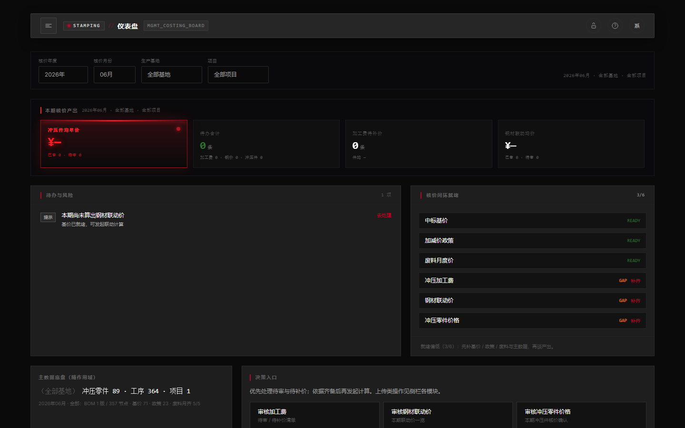
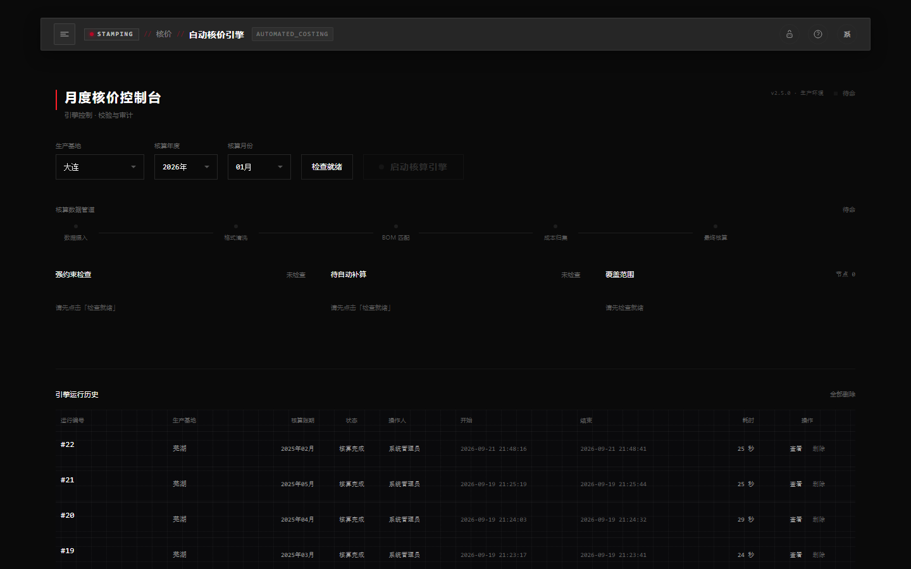
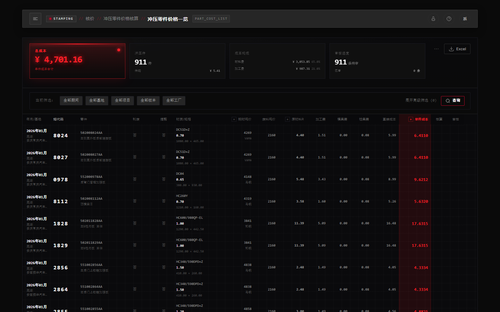
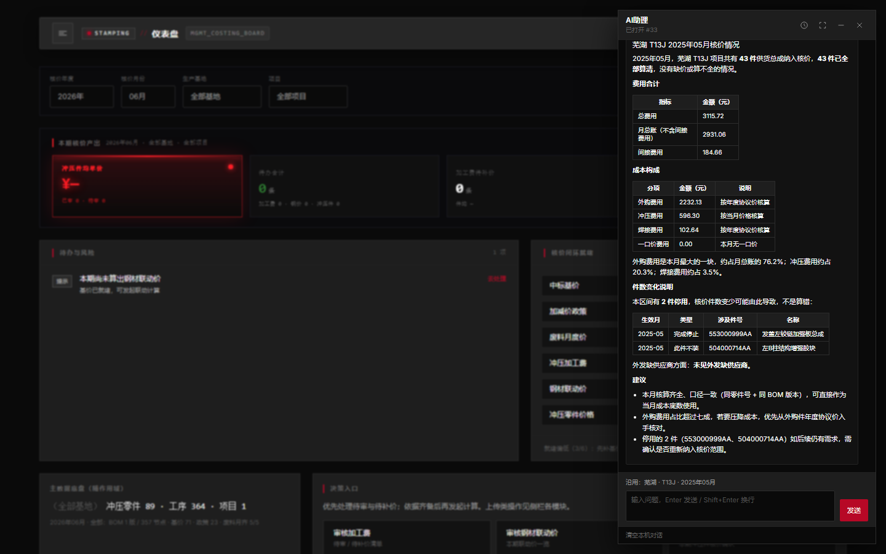

**English** · [简体中文](README.zh-CN.md)

# Structural Parts Automated Costing Platform

Monthly costing for automotive structural parts: assemblies, sub-assemblies, and stampings. Process sheets, negotiated steel prices, BOMs, and engineering changes land in one system. Prices are computed in the domain layer. The assistant only explains figures the costing library already produced.

Dark operations console. Carbon black, titanium panels, signal red.

---

## Product

<p>
  
  
</p>
<p>
  
  
</p>

A buyer’s month closes in a fixed order. Source workbooks come in. Steel moves with the mill. Each stamped part becomes material plus conversion. Weld and purchase prices fold in. The assembly price is what finance and procurement both read. A readiness gate blocks the engine until scrap prices, policies, and fees for that plant and month are present. Every engine run is numbered, timed, and kept.

Ask “how did Wuhu T13J close in February?” and the reply cites the same rows as the grid: purchased, stamped, welded, overhead. The model does not invent a price.

---

## Scope

| Area | What it holds |
|------|----------------|
| **Master data** | Plants, vehicle programs, suppliers, steel grades, mills |
| **Stamping** | Process-confirmation workbooks, parts and operations, stroke rates, die and gauge fees, conversion cost |
| **Negotiated steel** | Thickness / width / zinc policies, base prices, winning thickness, monthly scrap selling price |
| **Welding & BOM** | Indented BOM and sketches, weld rates, annual part prices, packaging and freight, weld breakdown, weld cost |
| **Engineering change** | Design changes and material changes that the next close must see |
| **Costing** | Steel linkage, part price, assembly rollup, monthly engine, close pack, procurement price agreement |
| **File trace** | Archived workbooks, filtered and downloaded under the same permission codes |
| **AI assistant** | Natural-language questions over a closed period; Markdown answer, history, print and Word export |
| **Access** | Login, role permission codes on every route and in the sidebar, operation log |

Typical path: process, policy, base price, scrap, and BOM are stored → steel linkage → part cost → assembly cost → engine → readout.

---

## Engineering

The repository is a vertical-slice monolith. Each business area (`stamping`, `yishiyiyi`, `bom`, `costing`, `llm`, …) owns its router, service, repository, models, and Excel parser. Calls go in one direction:

```
Router → Service → Repository → Database
```

Parsers are pure functions. Only a service may call them. Upstream slices do not import costing. Costing composes master data, stamping, negotiated steel, and BOM. The LLM slice reads result tables and does not become a dependency of the pricing engine.

A few rules that keep a long-lived costing codebase reviewable:

- **Numbers stay in the domain.** Services return typed view objects. JSON leaves through `ApiResponse[T]` and `PageResult`. Decimal and datetime formatting lives on the schema, not in a router.
- **The monthly engine is a conductor.** Prepare the scope, run the pipeline, persist. The orchestrator does not loop over parts or write SQL.
- **Long jobs are polled.** Upload and calculate return a `task_id`. The request session never crosses into the worker thread.
- **Permissions are codes, not page checks alone.** `Perm.*` is required on the route and mirrored in the SPA, so a hidden menu item is not an open API.
- **Python is checked before it is committed.** Ruff formats at 100 columns. Mypy runs in `strict` mode over `app/`, wired through pre-commit.
- **Workbooks remain evidence.** Imported files are archived and registered. A price row can point back at the mill file and the cell range it came from.

Architecture walkthrough: [docs/architecture.md](docs/architecture.md).

---

## Stack

| | |
|--|--|
| API | FastAPI, Pydantic v2, SQLAlchemy 2 |
| Data | SQLite (`data/stamping_costing.db` plus `data/auxiliary.db` for sessions and tasks) |
| Workbooks | OpenPyXL, xlrd, Pillow for embedded sketches |
| UI | ES-module SPA in `static/`. Hash router, checked-in Tailwind, no bundler |
| Auth | Token (`X-Token` or Bearer) and permission codes |
| Assistant | OpenAI-compatible chat API. Empty `LLM_API_KEY` falls back to a rule-based summary |
| Ship | Windows one-click install, or Docker via `deploy.sh` |

Python **3.12+**. License **MIT**.

---

## Run locally

```powershell
python -m venv .venv
.\.venv\Scripts\Activate.ps1
pip install -r requirements.txt
pip install -r requirements-dev.txt
copy .env.example .env
pre-commit install
python main.py
```

macOS and Linux: `source .venv/bin/activate`, then `cp .env.example .env`.

| | |
|--|--|
| App | http://localhost:8000/app |
| Login | http://localhost:8000/login |
| OpenAPI | http://localhost:8000/docs |

First boot with an empty user table creates **`admin` / `admin123`**. Change that password before any shared deploy.

Configuration lives in `.env` (see `.env.example` and `app/config.py`). The switches that change behavior:

| Variable | Role | Default |
|----------|------|---------|
| `APP_ENV` | `development` / `production` / `test` | `development` |
| `DATABASE_URL` | Main library | `sqlite:///./data/stamping_costing.db` |
| `PASSWORD_SALT` | Password digest salt | built-in; override in production |
| `LLM_API_KEY` | Assistant key | empty → rule-based summary |
| `LLM_MODEL` / `LLM_BASE_URL` | Model and endpoint | `deepseek-chat` / DeepSeek |

On Windows, run ad-hoc scripts with UTF-8: `python -X utf8 script.py`. In PowerShell, chain commands with `;`.

Checks, same ones the commit hook runs:

```powershell
python -m ruff check app --fix
python -m ruff format app
python -X utf8 -m mypy app
```

Deploy notes: [Windows production install](docs/deploy-windows-production.md) (`scripts\windows\setup.bat`, no Python required on the target machine) and `bash deploy.sh` on a cloud host.

---

## Layout

```
stamping-costing-platform/
├── main.py                  # app factory, static mount, routers
├── app/
│   ├── routers/             # HTTP only: params in, response out
│   ├── services/            # rules, transactions, parsers, workers
│   ├── repositories/        # queries
│   ├── models/              # tables
│   ├── schemas/             # dto/ and vo/
│   └── parsers/             # Excel in, rows out
├── static/                  # SPA, login, AI assistant panel
├── docs/                    # architecture and per-slice designs
├── data/                    # SQLite
└── uploads/                 # archived workbooks and sketches
```

Page modules follow the sidebar: `static/js/features/`.

---

## Read next

| | |
|--|--|
| [Architecture](docs/architecture.md) | Layers, slices, and why the dependency arrows point the way they do |
| [Document index](docs/README.md) | Design notes per slice |
| [Permissions](docs/permission-design.md) | How codes are granted and enforced |
| [AI costing readout](docs/llm/llm-costing-analysis-report-design.md) | What the assistant is allowed to say |
| [Windows deploy](docs/deploy-windows-production.md) | Install without a Python toolchain |

---

## License

MIT
