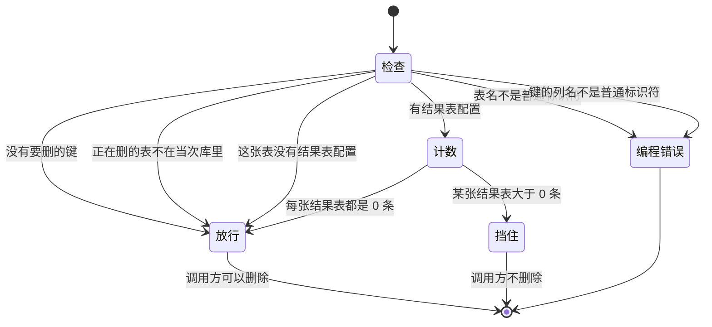
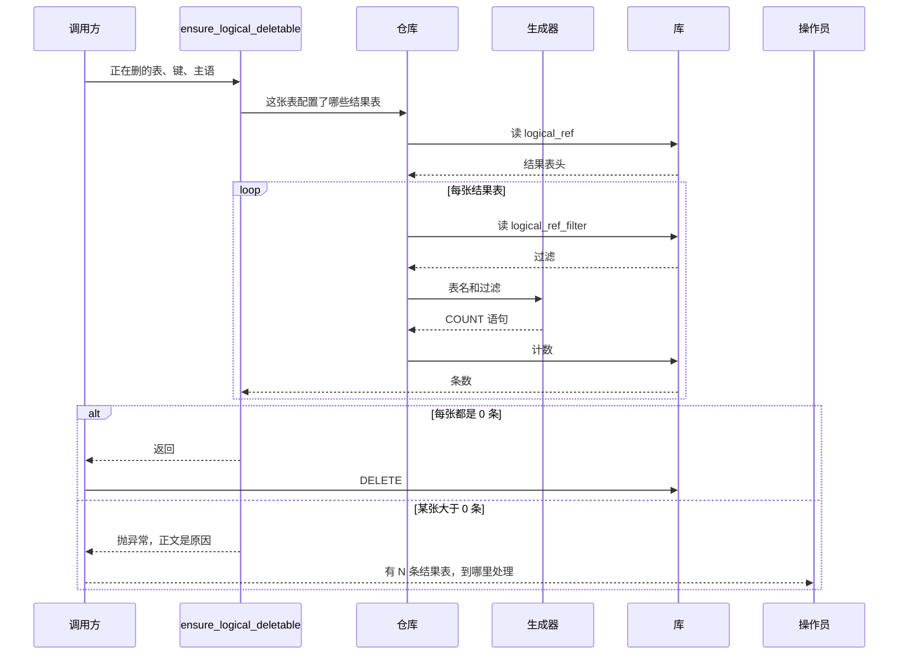

# 逻辑引用删除

只读这一份就能看懂 `service.py` 的 `ensure_logical_deletable`。它不发现外键，不读外键配置。外键是另一次调用。

配置在 `logical_ref`（结果表是什么、表名）和 `logical_ref_filter`（过滤）。种子在正在删的那张表所属模块。表结构和算子见 `docs/settings/logical-ref-design.md`。

本函数不 `commit`，不开新连接。返回即允许调用方 `DELETE`。抛异常则调用方不删。

## 状态



表不在库里时放行，并打 warning。没有配置也放行。少登记等于删的时候不挡。

## 时序

外键检查在这次调用之前，另一次完成。下面只画逻辑引用。



没有键、表不在库里、没有配置时，检查直接返回，不读过滤、不计数。

## 挡住时操作员看到什么

异常只有这一句正文，操作员和日志看到的是同一段：

```text
无法删除{主语}，原因如下：
  - 有 N 条{结果表是什么}，{处理建议}
请处理完以上数据后再删除。
```

主语由调用方传入，例如「该材料变更」。不传则是「该记录」。`结果表是什么` 和 `处理建议` 来自该行 `logical_ref` 的 `result_name`、`hint`。一张正在删的表可以挡住多张结果表，每张一行。

## 计数在问什么

对每一张结果表：过滤按 `seq` 用 AND 拼成 `COUNT`。大于 0 就挡住。生成器不认识具体业务表，列和比较都来自 `logical_ref_filter`。
