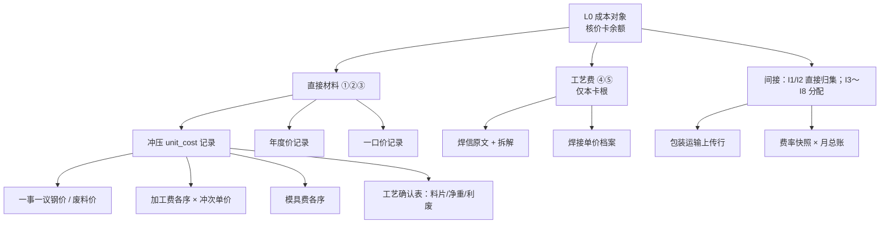

# 总成核价 — 计算过程

> **状态：已落地。** 只读装配已落库记录，不算第二遍价。  
> 分总成展示口径见 [assembly-cost-restore-ledger-display-design.md](assembly-cost-restore-ledger-display-design.md)（已落地）。  
> 切片：`costing` / `assembly_cost`。公式与结果表仍以 [assembly-costing-design.md](assembly-costing-design.md) 为准。  
> 硬约束：[architecture.md](../architecture.md)。  
> 入口：一览操作列「**计算过程**」→ 浏览器新页签 `/assembly-cost-restore?...`。  
> 外观：浅底、封面 + 章、构成树可折叠。打印带操作人/时间水印。禁止碳素黑 / HUD / 筛选条。  
> 权限：不新开码。能看一览就能看本页。  
> 页签 `<title>`：`{part_number} {year}年{month}月计算过程`。  
> 对外文案：**计算过程**。不要再写「还原」「成本追溯」。

---

## 0. 一句话

**用户在一览上觉得某张卡金额或状态不对时，新开一页报告，顺着 BOM 节点把账还原回去，并列出这条账用过的每一份 Excel。**  
不算第二遍价。不新建结果表。不是核价台黑底页。观感要对标屏幕上的工业画册 / 零件图册（大屏、留白、短码与金额），**不是**把网页排成 A4。不要对标后台表格。

```text
觉得异常（金额跳、partial、缺价、对不上）
  → 新页签 · 成本还原报告（浅底）
  → 各节点（本卡根 → 子件 → 冲压/年度价/焊接）
  → 各 Excel（工艺表、钢价、冲次、焊价、年度价、包装、BOM…）
```

---

## 1. 术语（质量 + 会计）

对外文案用下表。禁止再发明「详情升级」「过程页 2.0」这类内部黑话当产品名。

### 1.1 会计（成本会计 / 管理会计）

| 标准术语 | 英文 | 在本页的含义 |
|----------|------|----------------|
| **成本对象** | cost object | 这一张核价卡：某年某月某基地某项目某 BOM 版本下的一个 BOM 节点 |
| **成本还原** | cost restoration | **本报告的产品名与主方法**：把综合成本（月总账、`unit_cost`、焊接费合计）拆回原始成本项目，并印到节点与 Excel |
| **成本追溯** | cost tracing | 会计方法：直接成本按标识归到成本对象（材料、本卡焊接、I1/I2）。是还原时用的归类，**不是**报告标题 |
| **成本分配** | cost allocation | 间接费用按分配基础摊入（I3～I8）。报告只展示已分配结果与分配基础，不重摊 |
| **成本项目** | cost element | 直接材料、工艺费（焊接）、制造费用/期间费用（I1～I8） |
| **成本动因** | cost driver | 有效用量、过程量、费率基数（本卡 `total_amount`） |
| **原始凭证** | source document | 上传的 Excel、工艺确认表、BOM 焊信原文、冲次单价档案 |
| **核算记录** | accounting record | 已落库的结果行：零件价、焊接费、年度价、包装、系统费率快照 |
| **审计轨迹** | audit trail | 从成本对象金额一路能指到核算记录与原始凭证，中间不断链 |

还原时仍要分清方法：**直接归集**（冲压叶子 `unit_cost × 有效用量`、本卡焊接、I1/I2）对 **分配**（I3～I6 按费率 × 月总账）。分配项不要写成「从钢厂追来的」。

### 1.2 质量（ISO 9000 / IATF 16949 可追溯性）

| 标准术语 | 英文 | 在本页的含义 |
|----------|------|----------------|
| **可追溯性** | traceability | 能追踪某对象的历史、应用或位置。本页对象是**成本**，不是批次实物 |
| **向后追溯** | backward traceability | 从核价卡金额回到构成它的记录与凭证。本页只做这一向 |
| **标识** | identification | 零件号、BOM 节点 id、年/月/基地/项目/版本。断标识则断链 |
| **记录** | record | 已落库的核价卡、材料明细、间接行、上游结果表 |
| **客观证据** | objective evidence | 可核对的数据：公式恒等式、匹配键、文件溯源登记、Excel 行号 |

**不做向前追溯**（从一张钢价单扫到所有用过它的总成）。那是价表影响分析，不是本报告。

### 1.3 与现网其它页的分工（名称不要撞）

| 现网 | 标准上它是什么 | 本报告不是它 |
|------|----------------|--------------|
| 一览「眼睛」抽屉 | 成本对象的**账户余额**（材料行 + 间接行） | 到明细即停，没有还原、没有凭证 |
| 计算历史「过程」 | 一次作业的**核算日志**（整趟多卡） | 批次过程，不是单个成本对象的还原 |
| `#/file-trace` **文件溯源** | 已落盘上传件的**文件级可追溯性** | 本页在凭证层**引用**它，不复制文件中心 |
| 结果表 / 工程变更 Excel | 对外报送的**账表** | 对账用，不是审计轨迹 |

按钮文案：**计算过程**。封面眉题：**计算过程**。  
**浏览器页签头 `document.title` / `<title>` 写死为：**

```text
{part_number} {year}年{month}月计算过程
```

`part_number` 用本卡根**完整零件号**。月份两位。例：`501006873AA 2026年07月计算过程`。

**报告正文：短码是核对主键。** 封面、节点、例外、资料出处先写短码。外购紧固件（螺母等 / `N|Q|QR|FQ` / 标准件）短码列用**全码**，不要末四位。自制冲压与普通外购板仍用末四位。

---

## 2. 为什么要做（查异常，不是日常看板）

主路径仍是一览核价。本报告只在 **感觉有异常** 时打开：金额离谱、核算 partial、缺价、恒等式对不上、和二级报价对不齐。作用是把综合成本 **还原** 成节点与凭证：

| 还原出什么 | 用户要看见 |
|----------|------------|
| **各个节点** | 本卡根、walk 到的每个子件/叶子、一口价剪枝点、本卡焊接节点；哪一层断了、哪一层金额从哪来 |
| **各份 Excel** | 这条账实际用到的上传件：文件名、类别、行号；原件去文件溯源功能页找 |

不是再给财务一张黑底密表。一览继续碳素黑；本页是给人对着**显示器**把问题看清楚的报告。浏览器打印能出即可，不为纸张做第二套版。

| 缺口 | 标准上缺的是 |
|------|--------------|
| 抽屉只列 `items` / `indirects` | 有记录，无还原、无凭证 |
| 过程报告按 `log_id` | 作业日志，不是这个成本对象的节点+Excel |
| 月度核对导出叠很多 Sheet | 多对象汇总，不能单件还原 |
| 要自己去五个功能页翻原件 | 异常时拼不齐证据 |

本页补的是：**异常入口 × 单成本对象 × 节点树 × Excel 索引**。

---

## 3. 产品边界

### 3.1 做

- 一览操作列 **计算过程** → `window.open` **新页签**。
- 打开即全文：例外、恒等式、全部节点、工序分项、本账用到的 Excel 文件名与行号，一次排好。
- 恒等式与 [assembly-costing-design.md](assembly-costing-design.md) §3 相同，用核算记录验算（账证相符），对不上标异常。
- 需要纸件：浏览器自带打印即可。不要在报告上做工具条，**不要按 A4 做版心**。  
- **第一期不做** `restore/export-download`。交付物是屏幕上的 HTML。

### 3.2 不做

| 禁止 | 原因 |
|------|------|
| 再算一遍 walk / 零件价 / 焊接费 | P19：本切片只读上游记录 |
| 新表存还原结果 | 由已有 FK / 匹配键拼出，不落第二套账 |
| 把子孙焊接费加进树根 | P21 |
| 把子卡 `should_cost` 加进父卡 | 父卡材料已含（或一口价替代）子树；子卡是另一成本对象 |
| 整行点击进报告 | 前端规范：操作只走操作列 |
| 做成右侧抽屉 / SPA `#/` 页 | 这是报告页签，不是核价台再开一屏 |
| **黑底、HUD、碳素密表、霓虹红字** | 主应用浅色主题已否决，**不适用于本独立报告**；本页必须浅纸面。禁止复用一览 `template.js` 的 `#0A0A0C` |
| **报告上的筛选 / 工具条** | 不要抄计算过程日志页的筛选条。构成树允许 `<details>` 折叠；自制冲压 / 分总成可开下级计算过程 |
| **做成「浅色 Excel」或过程报告翻版** | 本页是画册。禁止工具条、密表堆砌、整页灰线框。计算过程页只借浅底，不借版式 |
| 并进计算过程那一份 HTML | 日志 ≠ 成本对象；只借用浅底纸面 |
| 按批次/炉号做实物追溯 | 质量上的产品可追溯性不在本切片；本页只还原**成本** |
| 新权限码 / 第二道 `can()` | 能看一览就能看；见 §3.4 |
| 对外仍叫「成本追溯报告」 | 产品名已定为成本还原报告 |
| **按 A4 / 打印分页做画册** | 画册级指**屏幕**气质。禁止 `@page A4`、章前强制分页当主设计 |

### 3.3 范围键（标识）

成本对象标识 = `costing_assembly_costs.id`。业务键与主表相同：

`(year, month, location, vehicle_model, bom_version, source_node_id)`

BOM 重导后 `source_node_id` 可能失效（P18）：报告仍展示**当时核算记录**；结构树若对不上当前 snapshot，页头标明「标识与现行 BOM 不一致，请重算后再打开还原报告」，不要 silently 用新树重走 walk。

### 3.4 权限（不新开）

还原报告是一览查看的一部分，不是单独功能。

| 动作 | 权限 | 不要做成 |
|------|------|----------|
| 操作列「还原」、打开报告页、`GET …/restore` | 现网 `op:assembly-cost:view` / `Perm.ASSEMBLY_COST_VIEW` | `op:assembly-cost:restore`、菜单码、角色里再勾一项 |
| 一览另下本报告工作簿 | **第一期不做** | 绑 export、在报告上放下载钮 |

前端：能进 `#/assembly-cost` 就渲染「还原」。报告页本身不再判断权限以外的任何点击。原件下载仍在文件溯源功能页，报告只**印**文件名与类别，不内嵌下载。

---

## 4. 还原模型（四层）

向后还原固定四层。缺一层就在该节点写「断链」+ 原因，不要跳过装齐。

```text
L0  成本对象余额
      grand_total / total_amount / 恒等式 / 状态 / 审核

L1  成本项目（本切片归集结果）
      ①②③ 直接材料    ④⑤ 工艺费（本卡根焊接）
      I1/I2 直接归集    I3～I8 分配计入

L2  核算记录（上游结果表，只读）
      冲压零件价 / 年度零件价 / 焊接费 / 包装运输 / 系统费率快照

L3  原始成本项目 + 原始凭证
      钢价一事一议、废料价、冲次单价、模具单价、焊价、工艺确认表尺寸、
      BOM 焊信原文、拆解明细、文件溯源登记
```



**财务视图**关注树根卡的 `grand_total`（总费用，对齐一览财务列）。**采购视图**关注对象卡的 `total_amount`（总成本，对齐一览采购列 / 协议分总成结算价）。链条相同；封面强调列随入口 `view` 变，不两套还原规则。

---

## 5. 成本还原规则（按成本项目）

金额公式不新发明，只规定**展示顺序与断链时怎么写**。

### 5.1 L0 成本对象

封面只放主角金额（§6.2）。账证核对放在第 3 章，不要和封面抢戏。

```text
material_amount      = ① + ② + ③
total_amount         = material + ④ + ⑤
should_cost          = total_amount
indirect_amount      = I1+…+I8
grand_total          = total_amount + indirect_amount
```

每条写：**记录值 | 按明细加总值 | 是否相符**。不符 → 列入例外章（与落库 `failed` 纪律一致）。

还要：零件号/名称、短码、level、是否树根、`object_kind`、所属供货件、`supply_qty`、`formula_version`、计算时间、`calc_batch_id`、审核状态。有子件的树根不展示价差（P15），报告里报价区标注「本对象不对二级开总成合同」。

### 5.2 直接材料

材料 walk 与总成核价正文 §5 相同。报告用**树状缩进**，不要只甩扁平 `items`。

**树怎么来（P18）：** `costing_assembly_cost_items` 没有父节点列。缩进用 `sort_no` 顺序 + `node_level`。若卡上 `bom_snapshot_id` 仍在，允许只读**该次** snapshot 的 `parent_id` 画真树。禁止用**现行** BOM 重走 walk 或补节点。snapshot 已没：只按 `node_level` 缩进，页头进例外「结构树无法按当时 BOM 还原」。

| `cost_source` | 会计含义 | L2 记录 | L3 凭证 |
|---------------|----------|---------|---------|
| `stamping` | 直接材料：自制冲压件标准成本 | `stamping_part_costs`（当月 `success`） | 见 §5.3 |
| `annual` | 直接材料：外购/年度协议价 | `bom_annual_part_prices` | 年度价上传 Excel（文件溯源 `bom_annual_part_price`） |
| `bundle` | 一口价：子孙不还原进本对象材料 | 该分总成年度价 | 同上；后代标 `skipped_by_bundle` |
| `skipped_by_bundle` | 被包价剪枝，**不计入**本对象材料 | 无金额 | 保留用量与包价父件标识，避免误当缺价 |
| `missing` | 断链：无冲压记录且无年度价 | — | 写匹配键与 `match_hint`（含 `dash_fallback:` / `multi_supplier_unit_cost`） |

每条材料行展示：

- **短码（主标识）** + 完整零件号（次行）+ 名称、`node_level`、`bom_node_id`、路径用量连乘（成本动因）
- `unit_price × effective_qty = line_amount`
- 匹配键仍用完整零件号（系统取价），不要用短码去匹配
- 多工厂 `unit_cost` 相同：注明「记录任取一条，金额一致」。冲突：已是 `missing`，展开冲突工厂与单价（客观证据）

**禁止**把另一张采购对象卡的结算价嵌进来充当本页材料。分组节点行金额 = **本页**该子树材料贡献；链接文案「采购对象」（新页签、`view=procurement`）。不要在本报告里嵌套整份子卡还原。自制冲压链接仍写「计算过程」。原因句只在总成零件构成里收起的「为什么分总成只计材料」。

### 5.3 冲压件标准成本还原（`unit_cost`）

成品侧抄的是零件级 **标准成本** `unit_cost`（`part-cost-v9`），不是再拆钢卷。还原必须写清两层费率，避免质量审核误判「重复计提」：

| 层级 | 会计性质 | 内容 |
|------|----------|------|
| 零件标准成本内 | 零件级附加 | `direct_cost` 上的财务/管理/仓储包装/税前利润 |
| 总成卡 I3～I6 | 总成级分配 | 基数 = 本卡月总账 |

零件还原：

```text
普通件 R = ① M×P×(1+λ) − ② M×λ×η×Q − ③ O×η×Q
利废件 R = H×Q          // 见 offal-nested-material-design.md
direct_cost = R + 加工费 + 模具费 + 检具费
unit_cost   = direct_cost + 零件级附加
本对象该行 = unit_cost × effective_qty
```

L3 必须展开到（有记录则展开，无则断链）：

| 原始成本项目 | 核算记录 | 原始凭证 / 客观证据 |
|--------------|----------|---------------------|
| 钢材采购 P | 零件价快照：`steel_mill`、`steel_ton_price`；有 `steel_price_id` 且行仍在则再印基价/厚度分项（只读，不重算） | 一事一议上传；文件名进资料出处。记录已删则只印快照，断链写「联动价记录已不存在」 |
| 废料 Q | `scrap_price_id` | 废料月度价（无上传件则只到记录） |
| 料片 M、净重 H、废料重 O | 零件价快照 L/W/T/可制件数/密度 | 工艺确认表；零件价上的 `excel_filename` / 行号 |
| 损耗率 λ、回收率 η、密度 | 零件价快照 | 系统配置当时快照（记录已拍） |
| 摆剪加价 | `swing_shear_fee_per_ton` | 系统设置快照 |
| 加工费 | `process_fee_id` + 各序 `stamping_process_fee_items` | 吨位来源（自有/继承/摆剪不计费）、冲次单价档案、`basis_text`；文件溯源 `stamping_tonnage_price` |
| 模具费 | `die_fee_id` + 各序 | 模具单价档案、布点；文件溯源 `stamping_die` |
| 检具费 | `gauge_fee_id` | 检具费档案；文件溯源 `stamping_gauge_fee` |
| 利废标识 | `is_offal_nested` / `offal_source` | 工艺确认表料片式样（不是布点） |

工序行：`process_seq`、代码、原始吨位、计价吨位、`tonnage_source`、系数 `cost_ratio`、冲次单价、`line_fee`、`basis_text`。继承吨位要写清来源零件号+工序。

模具行：估重、模具单价（万元/吨）、分摊系数、分摊套数（万台）、模具套数、`line_die_fee`、`basis_text`；主表还印合计与分摊套数。

拼焊：材料按子片各自 P 再汇总（现网零件价已做）；报告按零件价已存分项展示，不在总成切片重算子片。

### 5.4 工艺费（本卡根焊接）

④⑤ **只还原本卡根** 的 `bom_welding_fees`（P21）。无行 → 金额 0，**不是断链**（P7），文案：「无焊接核算记录，工艺费 0」。

有行则还原：

```text
各明细：billing_qty × unit_price = line_fee     // 不乘装配用量
total_welding_fee = Σ 已匹配行
final_welding_fee = total + other_fee
本卡 ④ = final_welding_fee（空则 total）
本卡 ⑤ = other_fee
```

L3：

| 证据 | 内容 |
|------|------|
| 原始凭证 | `weld_info_raw`（焊信原文） |
| 记录 | 拆解节点 id、`source_breakdown_line_id`、过程量、辅助量、标准工艺名、匹配状态 |
| 价表 | `bom_welding_unit_price`（基地+年+标准工艺名）；文件溯源 `bom_welding_unit_price` |
| 状态 | `unmapped` / `missing_price` → 该卡 partial 的客观证据 |

`fee.level ≠ R.level`：警告，仍用该行金额（与核价纪律一致）。

### 5.5 间接费用（直接归集 vs 分配，必须分开）

| 代码 | 标准归类 | 还原 |
|------|----------|------|
| I1 单件运输费 | **直接归集**到包装记录 | 基地+年+**本卡**零件号 → `unit_transport_fee`；无行 = 0，不断链 |
| I2 仓储+捆包 | **直接归集**到包装记录的 `other_fee` | 禁止用 `packaging_transport_total` |
| I3～I6 | **分配**：费率 × 月总账 | 展示卡上费率快照、基数、积；配置现行值仅作对照，不相等时注明「以核算时快照为准」 |
| I7 / I8 | 分配预留 | 上游未建 = 0，仍进总费用 |

包装文件溯源：`bom_packaging_transport_fee`。非树根卡 I1/I2 常为 0：这是标识（包装挂供货号）问题，不是公式分支，报告写明匹配键。

报价对照**不进本报告**（已从 VO / 页面删除）。`vendor_quote` 仍在核价卡上，一览自行对照。

---

## 6. 报告页（新页签 · 画册）

**载体：** 独立 HTML，新页签。浅纸面。**禁止**进 `static/index.html` 的 `#pageContent`，禁止套一览 HUD class。  
[light-theme-design.md](../light-theme-design.md) 否决的是**主应用换皮**；本页一开始就不是黑台。  
现网 `/assembly-cost-calc-report` 只借「独立浅页」这一载体，**版式不得照抄**（那页有筛选和工具条，密度像作业日志，不是画册）。

URL：`/assembly-cost-restore?year={year}&month={month}&part_number={part_number}`  
必带业务键，**不要用内部 id**。同号同月可能多张卡时再带 `location`、`vehicle_model`、`bom_version`（采购价格协议查询范围里本来就有这三项）。仍有多张时取第一张（财务优先树根，采购优先采购对象，否则按 `id` 升序第一张）。  
树上每个节点可新页打开该件的计算过程；同号多张卡取第一张。

### 6.1 观感标准（画册级 = 屏幕）

落地必须让人在**显示器上**觉得这是给这颗零件做的图册，不是系统里又开了一张表。对标：大屏上的汽车零件图册、高订品牌官网内页、博物馆展签。不要对标用友 / Excel / 后台 CRUD，也**不要对标 Word 排 A4**。

| 要（屏幕） | 不要 |
|----|------|
| 先看见短码与那一笔钱，再看见账 | 打开就是表头 + 密行 |
| 封面占一屏、其后各章用大留白隔开 | 一条横线当标题，下面直接表格 |
| 版心按宽屏（约 1200–1440px），呼吸感 | 缩成 210mm 栏宽装「纸感」 |
| 金额是主角（等宽、右齐、字号差开） | 所有数字同一号、同一灰 |
| 断链用安静的酒红，单独成章 | 霓虹、闪点、整行大红底 |
| 滚动流畅、章之间像翻过一页 | 为打印加分页符、页码条、页眉页脚抢戏 |

字体（只用仓库已有本地字体，禁止 Google Fonts）：

| 角色 | 用 |
|------|-----|
| 画册名、章名、**零件短码** | 衬线（`Source Serif 4`），短码是正文最大号之一 |
| 说明、名称 | Inter / 系统 UI |
| 完整零件号、金额、公式 | 等宽 tabular；完整号明显小于短码 |

色：象牙底 `#fffdfa`，周围暖灰 `#efe8dc`，墨 `#1c1917`，唯一强调酒红 `#9f1239`。**一种红。** 禁止 `#FF1E27` glow，禁止第二套品牌蓝。

### 6.2 装帧（屏幕优先）

主舞台是浏览器视口。长卷往下滚；封面、各章用**大块留白**分开，像屏幕上翻画册，不是 `border-collapse` 连成一张表。

打印：不拦浏览器 Ctrl+P，**不为纸张重做布局**。不要 `@page A4`、不要章前 `break-before: page`、不要打印专用页眉页脚。印出来能读即可。

**封面（第一屏）** 只放这些，留白要大于内容：

- 眉题小字：计算过程
- **零件短码（最大字）**；其下完整零件号 + 名称
- 一笔主角金额：财务 `grand_total`（总费用），采购 `total_amount`（总成本）
- 标识一行：年/月 · 基地 · 项目 · BOM 版本
- 核算 / 审核状态用短词
- 文末细字：核价人、核价时间；水印：公司核心机密 + 操作人 + 打开/打印时刻

有例外时，封面之后立刻是「例外」章，不要把断链藏在文末。

**章扉：** 每章一个短衬线标题 + 一句会计用语（如「直接材料」「本卡工艺费」），然后才是内容。章号用 `01` 细字，不要色块。

### 6.3 章节顺序（异常优先，一次印全）

章节是屏幕上的标题，不是点了才出现的控件。

1. **封面**
2. **例外与断链**（缺价、价冲突、焊接 partial、恒等式不符、标识失效）— 没有则一句话「本对象核算记录完整」，仍占一小节。清单每条先写短码再写完整号
3. 账证相符（恒等式：记录值 / 加总值 / 是否相符）
4. 成本项目（瀑布做成竖向金额叙事，不要八列表头）
5. **节点树**：每个 BOM 节点一块图录：**短码最大**、完整号细字、名称、来源、金额、对应 Excel 文件名；冲压叶子在同一块里写出 R 公式与各序
6. **工艺：** 焊信原文（引用排版）→ 拆解行 → 单价
7. 间接：直接归集与分配分成两节，科目名用人话
8. **资料出处：** 本账用到的 Excel（文件名、类别、被哪些节点引用、行号）。同一文件出现一次。放长卷末，不是附件垃圾桶

### 6.4 节点怎么排（仍是静态）

- 树用缩进 + 细线，不要 HTML 宽表撑满 20 列。
- 叶子块：**左上短码（主）**、其下完整号细字、再下名称；右金额。公式与工序用较小字，行距松开。
- `missing` / 冲突：该块左边一条细酒红；例外句里也先出现短码。
- 工序、模具序、焊明细：**全部写出**。长就往下滚，不要为「一页纸」砍内容。
- 资料出处「被哪些节点引用」写短码列表，完整号可括注。

### 6.5 静态（报告上无交互）

- 一览：`window.open('/assembly-cost-restore?year=&month=&part_number=…')`，`noopener`。同号冲突时带基地/项目/版本。
- 取数一次，渲成 HTML。构成树 `<details>` 可折叠；自制冲压可开下级「计算过程」；分总成开「采购对象」。外购件无链接。封面无教育导语。
- `boot.js` 取数填纸。鉴权带登录态；401 印「请先登录核价台后再打开」。页签头 `{part_number} {year}年{month}月计算过程`。
- 水印：公司核心机密 + 当前操作人 + 打开/打印时刻。
- `view` 从 URL 带入（一览当前财务/采购）。缺省 `finance`。

一览改动：操作列在「眼睛」旁加 **计算过程**。不要删眼睛。

### 6.6 落地检查（观感）

未达到下面任一条，视为未完成，不要用「数据齐了」过关：

1. 封面在宽屏上能单独截图当这颗零件的卡片。  
2. **屏幕**打开像图册，不是网页长表，更不是 A4 预览。  
3. 坐在显示器前能先读到**短码**和那一笔金额。  
4. 没有筛选条、没有「导出/打印」按钮、没有黑底。  
5. 表格不是视觉主角；短码、数字和章名才是。

---

## 7. API（落地时）

只读。不算价。`ApiResponse[T]`。

```text
GET /api/costing/assembly-costs/restore?year=&month=&part_number=
```

可选 `location`、`vehicle_model`、`bom_version`、`view`。同号同月多张卡时带范围缩小；仍多张则取第一张，不报 400。  
兼容：`GET /api/costing/assembly-costs/{cost_id}/restore`（一览不再用）。

第一期不要导出路由。

- 404：没有这张核价卡。  
- `require_perm(Perm.ASSEMBLY_COST_VIEW)`，与 get 详情相同。  
- 查询可选 `view=finance|procurement`：只影响封面强调列（总费用 / 总成本），VO 仍含全部项目。缺省 `finance`。  
- `/restore` 与 `/{cost_id}/restore` 必须写在 `GET /{cost_id}` **之前**。

VO 分层（禁止 `dict[str, Any]` 把上游整行 dump 出去）：

| VO | 内容 |
|----|------|
| `AssemblyCostRestoreVO` | 对象标识、封面金额、恒等式核对、材料树、焊接、间接、断链清单、凭证索引、核价人 |
| `RestoreIdentityCheckVO` | 各恒等式左右值与是否相符 |
| `RestoreMaterialNodeVO` | 明细 + **短码** + 完整号 + `cost_source` + 可选 `stamping` / `annual` 子对象 |
| `RestoreStampingVO` | `unit_cost` 还原：R 三项、加工费序、模具序、检具、钢价/废料指针 |
| `RestoreWeldingVO` | 主表金额 + 明细行 + 焊信原文 |
| `RestoreIndirectLineVO` | `direct` \| `allocation` + 记录/快照 |
| `RestoreDocumentRefVO` | `file_category`、上传文件名、行号、被哪些节点引用。可带文件溯源 id 供服务端核对，**页面不渲染链接** |

装配在 `assembly_cost` 切片 Service（新建 `restore/` 包，对标 `calc_report/`）。**允许**只读上游 Repository / 稳定查询。禁止调任何 `calculate`。`restore/` 与 `export/`、`calc_report/` 互不 import。

取数：一次 GET 按卡上的 id / 零件号 **批量**拉上游，禁止每个叶子 N+1。记录已删（重算覆盖后 id 失效）：该节点断链「核算记录已不存在」，不要改用现行价表顶上（那会破坏审计轨迹）。

---

## 8. 代码锚点

```text
docs/costing/assembly-cost-restore-design.md          # 本文
docs/costing/assembly-cost-restore-ledger-display-design.md  # 总成/采购对象展示（已落地）
app/services/costing/assembly_cost/restore/        # 装配 VO
app/routers/costing/assembly_cost/crud.py        # GET restore（无 export-download）
app/schemas/vo/assembly_cost_restore_vo.py
static/assembly-cost-restore.html
static/js/features/costing/assembly-cost/restore/boot.js
static/js/features/costing/assembly-cost/list/    # 操作列按钮
tests/costing/test_assembly_cost_restore.py
```

`boot.js` 只取数填纸。CSS 按 §6 画册另写，**禁止** import 一览 HUD，**禁止**复制 `assembly-cost-calc-report.html` 的工具条与筛选。**不要**做成 SPA `pageConfig`。URL 不随目录搬家。

---

## 9. 验收（设计检查，落地对照）

1. 点「计算过程」是**新页签**；页签头 `{part_number} {year}年{month}月计算过程`；浅底；构成树可折叠。  
2. 打开即报告：无缺价则无缺价章；资料来源在文末。  
3. 外购件 / 一口价无「计算过程」链接；自制冲压与分总成可开。  
4. 树根工艺费 = 该树根自己的焊接记录，不含子孙。  
5. 一口价子孙看得到、金额为 0、标明已含在一口价。  
6. 冲压叶子能还原到加工费、模具、钢价指针。  
7. I3～I6 标明**分配**与费率快照；I1/I2 标明**直接归集**到包装记录。  
8. 无上传件的数据只印核算记录。  
9. 商务入口封面是总成价；采购入口是结算价，不展示摊入章。构成树里点分总成「采购对象」仍开采购口径。总成树上分总成行金额不含采购对象焊装。原因只在零件构成收起项。  
10. 紧固件短码列是全码（如 `QR36410`），外购板是末四位（如 `1133`）。  
11. 不写库、不调用上游计算。  
12. 恒等式展示值与卡上余额一致。  
13. 只有一览查看权即可打开；catalog 无新码。  
14. 观感过 §6.6：**屏幕**像图册；数据齐但版式像后台表或像 A4 排版 → 不算落地。

---

## 10. 与总成核价正文的关系

公式、P1–P22、表结构仍只维护在 [assembly-costing-design.md](assembly-costing-design.md)。本文只增加 **成本对象怎么还原给人看**。若公式变更，本报告跟随结果表，不单独改口径。总成 vs 采购对象的展示见 [assembly-cost-restore-ledger-display-design.md](assembly-cost-restore-ledger-display-design.md)。
