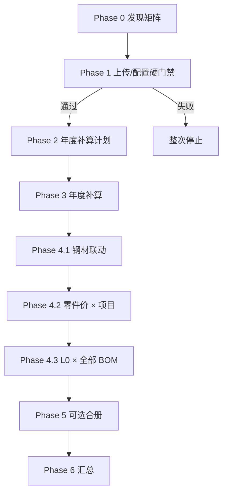

# 月度智能自动核价引擎 — 详细设计

> 面向产品、实施与开发复核。  
> 入口仅 **基地 + 年度 + 月份**；在既有钢材联动 / 冲压零件价 / 成品 L0 计算之上增加 **编排层**。  
> 硬约束见 [architecture.md](../architecture.md)；L0 取价规则见 [l0-assembly-costing-design.md](l0-assembly-costing-design.md)。  
> **状态：已上线。** 产品规则仍以本文为准；实现见 §19 代码锚点。  
> **产品入口：** `#/costing`；API `/api/costing/engine`。

---

## 1. 一句话说明

用户选定 **生产基地、年度、月份** 后一键启动；引擎校验上传/配置类主数据（缺则整次停止，并给出 **对应功能页快速跳转**），对缺失的 **年度计算结果** 自动补算，再按依赖跑完当月钢材 → 零件价 → 全部 BOM 版本的成品核价；前端只轮询 **一个异步任务**。

---

## 2. 已定产品规则（冻结）

| # | 规则 | 说明 |
|---|---|---|
| R1 | 入口三参数 | 仅 `location`（基地）、`year`、`month` |
| R2 | 上传/配置缺失 → 硬停 | 见 §5.1；含 **基准价、厚度加减价**；覆盖不全视为缺失 |
| R3 | 年度计算所得缺失 → 自动补算 | 加工费、焊接工艺拆解、L0 焊接费（`levels=[0]`） |
| R4 | 多 BOM 版本 → 逐个全算 | 同项目多版本全部进入计划，不「只算最新」 |
| R5 | 不改公式 | 复用现有 Orchestrator；合册只导出不算价 |
| R6 | 前端单通道异步 | 一次 `task_id` + 与现网同形的进度 VO |
| R7 | 硬停可跳转 | 每条硬停缺口须带 **功能页深链**，一点即达上传/维护处（见 §5.3） |
| R8 | running 也可删 | `costing_engine_run` **任意状态均可删除**（含 `running`），避免本机关机后任务永久卡住（见 §8.4） |

---

## 3. 现状与缺口

### 3.1 已有能力

| 能力 | 入口 | 异步 |
|---|---|---|
| 钢材联动价 | `POST /api/costing/steel-price/calc` | ✅ AsyncTask |
| 冲压零件价 | `POST /api/costing/stamping-part-cost/calc` | ✅ |
| 总成核价 | `POST /api/costing/assembly-costs/calc` | ✅ |
| 冲压加工费 | `POST /api/stamping/process-fees/calc` | ✅ |
| 焊接工艺拆解 | `POST /api/bom/welding-process-breakdown/generate` | ✅ |
| 成品焊接费 | `POST /api/bom/welding-fees/calc`（引擎补算传 `levels=[0]`） | ✅ |
| 月度核对合册 | `GET /api/costing/monthly-bundle/export-download` | 同步导出 |

### 3.2 实现状态

| 项 | 状态 |
|---|---|
| `#/costing` 与 `/api/costing/engine` | 已上线（就绪检查、启动 Run、轮询、历史删除含 running） |
| 「基地+年+月」展开为多工厂 × 多 BOM 并串链 | 已上线（`engine/orchestrator/` / `scope_discovery`） |
| Run 账本与「上传硬停 / 年度补算 / 月度主链」分类门禁 | 已上线 |

产品规则（R1–R8）仍以本文为准。目标页若暂不读 `navigate.query`，至少落到正确功能页（见 §12）。  

---

## 4. 架构定位

### 4.1 在切片中的位置

```text
上游：settings · stamping · bom · yishiyiyi
下游：costing（本引擎属于 costing 编排，只组合上游，不成环）
```

### 4.2 模块职责

```text
Router  /api/costing/engine/*
    │
    ▼
CostingEngineService                 ← 编排唯一入口
    ├─ ScopeDiscovery                ← 发现工厂、L0Scope（含全部 BOM 版本）
    ├─ GateChecker                   ← 上传/配置硬门禁（覆盖完整性）
    ├─ AnnualCalcPlanner             ← 年度结果缺失 → 补算计划
    ├─ RunOrchestrator               ← DAG 指挥（ensure → phases → finalize）
    └─ CostingEngineRunRepository    ← run / step 持久化

子计算（已有，引擎路径下同进程调用，不嵌套再开 AsyncTask）：
    SteelPriceCalcOrchestrator
    StampingPartCostCalcOrchestrator
    AssemblyCostCalcOrchestrator
    冲压加工费 / 焊接拆解 / L0 焊接费 Service
    MonthlyBundleExportService（可选 Phase，只导出）
```

| 组件 | 做 | 不做 |
|---|---|---|
| CostingEngine | 发现、门禁、调度、账本、父任务进度 | 核价公式、改结果金额字段 |
| 各 Orchestrator | 原计算与 scope 锁 | 总编排 |
| MonthlyBundleExport | 按成功 L0Scope 出合册 | 触发计算 |
| AsyncTask（父任务） | 前端轮询通道 | 替代业务结果表 |

### 4.3 分层约束

- Router：参数、权限、`ApiResponse[T]`，无业务分支  
- Engine Service：门禁策略、展开、状态机、调度  
- 子计算：保持现有 Service → Repository；引擎不得直接写各结果表业务字段  
- 跨切片：只允许 costing → 上游只读查询 / 上游稳定 calc API  

---

## 5. 数据三类与行为

### 5.1 上传 / 配置类（缺失 → 整次硬停）

必须对本 Run 将覆盖范围 **键可匹配、覆盖完整**；表非空但缺关键钢种/厚度档 = 缺失。

| 数据 | 粒度 | 备注 |
|---|---|---|
| 本期可引入项目 | 基地 + 年 + 月 | 问项目主数据 `list_introducible`；名单空硬停，去一览表 |
| 冲压工艺零件 / 工序 | 本期项目名单 | 对照零件表；缺工艺才去上传页。不要用空名单冒充「没有冲压零件」 |
| 冲次单价 | 基地相关 | 加工费输入 |
| 焊接单价 | 年 + 基地 | 上传 |
| BOM 材料清单快照 | 基地 + 项目 + BOM 版本 | 须含 L0 |
| 年度零件价 | 年 + 基地 | 上传 |
| 包装运输费 | 年 + 基地 | 上传；**缺失仅黄灯提示，不硬停**（成品卡 I1/I2 为 0） |
| **钢材基准价** | **年 + 月 + 基地** | **硬停**；按将算材料钢种覆盖 |
| **厚度加减价政策** | 政策匹配 | **硬停**；可匹配完整 |
| 宽度加减价政策 | 政策匹配 | 同属 5.1，硬停（允许「加减为 0 的合法命中」，不允许匹配失败） |
| 废料月度销售价 | 年 + 月 + 基地 | 硬停 |
| 系统费率等配置 | 全局 | 缺则停 |

> 无「缺失则计算」路径——没有可生成来源，只能停并列出缺口；**须提供快速跳转**（§5.3）。

### 5.2 年度计算所得（缺失 → 自动补算）

| 结果 | 触发粒度 | 依赖（须已过 5.1） |
|---|---|---|
| 冲压加工费 | 每个相关 `vehicle_model`（工厂空则覆盖该车各厂） | 工艺 + 冲次单价 |
| 焊接工艺拆解 | 每个 L0Scope | BOM + 焊接单价等 |
| 成品 L0 焊接费 | 每个 L0Scope | 拆解结果 |

规则：

- 仅当该 scope **尚无可用结果** 时补算  
- 已有结果（含已审核）→ **默认不重算、不覆盖**  
- 补算失败 → 仅阻断依赖它的下游单元，记入 step  

### 5.3 硬停 → 功能页快速跳转（必做）

硬停不是死胡同：`ready` / 门禁 UI 对 **每一条** `ok=false` 的上传/配置项，必须给出可点击入口，跳到系统内对应维护页。

#### 5.3.1 交互要求

| 要求 | 说明 |
|---|---|
| 位置 | 硬停红灯列表每一行右侧（或整行可点）提供「去处理」 |
| 形态 | Hash 路由跳转：`#/{page}`；有筛选参数时带 query（如 `?year=&month=&location=`） |
| 权限 | 无该页菜单权限时：按钮禁用 + 提示联系管理员；**不能**只藏跳转导致用户不知道缺什么 |
| 返回 | 跳转前可把引擎三参数写入 `sessionStorage`，方便处理完回到 `#/costing` 再点「检查就绪」 |
| 黄灯 | 年度「将自动计算」**不强制**跳转；可选提供只读列表页链接（加工费列表等），非阻断 |

#### 5.3.2 门禁 code → 页面映射（定稿表）

后端 `ready.upload_or_config[]` 每项携带 `navigate`（见 §11.1）；前端按此渲染，避免页面写死散落映射。

| gate `code` | 说明 | 主跳转（上传/维护） | 辅跳转（列表核对，可选） | 建议 query |
|---|---|---|---|---|
| `vehicle_model` | 本期可引入项目 | `#/vehicle-model-list` | — | `location`；名单空不要说「没有冲压零件」 |
| `stamping_process` | 冲压工艺 | `#/stamping-upload` | `#/stamping-parts` | `location`；对照本期项目名单，缺工艺才去上传页 |
| `tonnage_price` | 冲次单价 | `#/stamping-tonnage-upload` | `#/stamping-tonnage` | `location` |
| `welding_unit_price` | 焊接单价 | `#/bom-welding-unit-price-upload` | `#/bom-welding-unit-price` | `year`, `location` |
| `bom_snapshot` | BOM 材料清单 | `#/bom-upload` | `#/bom-material` / `#/bom-structure` | `location`；缺版本时文案点名项目 |
| `annual_part_price` | 年度零件价 | `#/bom-annual-part-price-upload` | `#/bom-annual-part-price` | `year`, `location` |
| `packaging_transport` | 包装运输费（软门） | `#/bom-packaging-transport-fee-upload` | `#/bom-packaging-transport-fee` | `year`, `location` |
| `base_price` | 钢材基准价 | `#/base-price-upload` | `#/base-price-download` | `year`, `month`, `location` |
| `thickness_policy` | 厚度加减价政策 | `#/steel-price-policy-upload` | `#/steel-price-policy-download` | 文案提示牌号/厚度缺口 |
| `width_policy` | 宽度加减价政策 | `#/steel-price-policy-upload` | `#/steel-price-policy-download` | 同上（同一政策模块） |
| `scrap_price` | 废料月度价 | `#/scrap-price` | — | `year`, `month`, `location` |
| `system_rates` | 系统费率等配置 | `#/settings`（或实际费率配置页） | — | 按现网设置页为准 |

> 映射随侧栏路由变更时 **只改后端常量 / 单一前端字典一处**，与 `pageMeta` 的 hash 名保持一致。

#### 5.3.3 `navigate` 字段（API）

每条硬停项：

```text
navigate: {
  page: "base-price-upload",           # 对应 hash 名（无 #/ 前缀）
  label: "去上传基准价",
  query: { year: 2025, month: 1, location: "青岛" },  # 可省略的键不要硬塞
  secondary_page: "base-price-download",              # 可选
  secondary_label: "查看基准价列表"                     # 可选
}
```

前端拼链：`#/${page}?${query}`（仅追加有值的 query）。  
`POST /runs` 因硬停被拒时，错误 `data` 中宜带回同一批 `upload_or_config`（含 `navigate`），便于引擎页不重新点「检查就绪」也能点跳转。

### 5.4 月度计算所得（引擎主链）

| 结果 | Scope |
|---|---|
| 钢材联动价 | `(location, year, month)` 整基地一次 |
| 冲压零件价 | 每个项目一次（覆盖该车各厂、各版本） |
| 成品 L0 核价 | **每个** `(vehicle_model, bom_version)` 一次 |
| 月度合册（可选） | 每个成功的 L0Scope 各出一册 |

---

## 6. 范围模型与发现

### 6.1 键

```text
RunKey       = (location, year, month)
SteelScope   = (location, year, month)
PartCostScope = (location, year, month, vehicle_model)
L0Scope      = (location, year, month, vehicle_model, bom_version)
```

### 6.2 发现规则

1. **项目**：该基地该月 `VehicleModelService.list_introducible` → 全部进入加工费补算与 PartCost 计划（一车多厂一次算完）。名单空则硬停，去项目一览表，不要说「该基地没有冲压零件」。  
2. **L0Scope**：该基地下所有 **含 L0 节点** 的 BOM 快照 `(vehicle_model, bom_version)`，且 `vehicle_model` 必须落在本期名单 → **全部进入计划（多版本逐个算）**。名单外的 BOM **不进入计划**。  
3. **地点规范化**：由 `LocationService.expand_for_query` 展开规范名与别名（如「青岛」/「青岛基地」），门禁与发现用同一套，避免假缺失。引擎 `get_ready` / `start_run` 先 `require_enabled`，只写入规范名。

### 6.3 与合册参数对齐

合册现需：年、月、基地、项目、BOM 版本。冲压侧按整车入册，工厂只出现在明细列。  
引擎导出阶段对每个成功 L0Scope 调用现有导出服务；不在合册内计算。

---

## 7. 执行流水线（DAG）



### 7.1 阶段说明

| 阶段 | 行为 |
|---|---|
| 0 | ScopeDiscovery：本期项目名单、L0Scope 列表 |
| 1 | GateChecker：§5.1；失败则 `can_start=false`，不建计算 Run（或仅检查记录） |
| 2 | 体检 §5.2，生成 `annual_plan` |
| 3 | 按项目补加工费（覆盖该车各厂）；按 L0Scope 补拆解 → L0 焊接费 |
| 4.1 | 整基地钢材联动 |
| 4.2 | 逐项目零件价（依赖 4.1 + 废料 + 加工费；工厂空） |
| 4.3 | 逐 L0Scope 成品核价（多 BOM 全跑） |
| 5 | 可选：成功 L0Scope 导出合册 |
| 6 | 聚合 Run 状态，写父任务 `result` |

### 7.2 同层并发

- 首版建议 **串行**（实现简单，与现有 scope 锁更好共存）。  
- 若并行：同 stage 多 scope 受限并行，且 **禁止** 父 AsyncTask 再 submit 子 AsyncTask 并在同线程池内阻塞等待（见 §9）。

---

## 8. 状态机

### 8.1 Run

| 状态 | 含义 |
|---|---|
| `blocked` | 仅用于「检查记录」场景；硬门禁未过（可选，首版可不落库） |
| `running` | 父任务执行中 |
| `succeeded` | 计划内应执行单元全部成功（跳过已审核可计入成功路径） |
| `partial` | 至少一单元成功，且存在失败/跳过导致未全绿 — **合法业务终态** |
| `failed` | 钢材阶段失败，或无一可继续的月度单元等 |

### 8.2 Step

`pending | running | succeeded | skipped | failed`

`skipped` 示例：已审核不覆盖；年度补算失败导致下游跳过。

### 8.3 失败传播

| 情况 | 后果 |
|---|---|
| Phase 1 硬停 | 不启动计算 |
| 钢材 4.1 失败 | Run=`failed`，不跑 4.2/4.3 |
| 某工厂加工费补算失败 | 该工厂零件价 skipped；其它工厂继续 |
| 某 BOM 的 L0 失败 | 该 step failed；其它版本继续 → 易 `partial` |

### 8.4 Run 删除（含计算中）

本系统常在 **个人电脑** 上跑：进程被关、关机、浏览器关掉后，父 Worker 不会回来，`running` 会一直挂着，次日无法开同 scope 新 Run（若有「同键进行中」互斥）。

**定稿：**

| 规则 | 说明 |
|---|---|
| 允许删除的状态 | **全部**：`running` / `succeeded` / `partial` / `failed` / `blocked`… |
| 删除范围 | `costing_engine_run` + 其 `costing_engine_run_step`（级联） |
| 父 AsyncTask | 尽力将辅助库任务标为 `failed`（或等价终态）并写明「用户删除 Run」；任务已 TTL 过期则可忽略 |
| **不回滚业务结果** | 删除 Run **不删除** 已写入的钢材/零件价/L0/加工费等结果表；只清编排账本。若需重算，走现网各模块规则（已审核跳过等） |
| 同键互斥 | 删掉卡住的 `running` 后，允许立即对同一 `(location, year, month)` 再 `POST /runs` |
| 前端 | 历史列表对 `running` 也提供「删除」；文案提示：用于清理中断任务，不撤销已算出的价格 |
| 确认 | 删除前二次确认即可；**不要**因 `running` 禁用删除按钮 |

实现注意：若进程仍活着、Worker 还在跑，删除后 Worker 写 step/更新进度可能失败——应吞掉「run 已不存在」类错误并结束，避免刷异常日志。无法强杀线程时，以「账本已删 + 允许新 Run」为成功标准。

---

## 9. 异步模型（与前端相通）

### 9.1 现网范式（必须对齐）

```text
POST calc → AsyncTaskAcceptedVO { task_id }
GET  .../tasks/{task_id} → AsyncTaskProgressVO
     { status, progress, msg, result, ... }
```

进度落在 **辅助库** AsyncTask（AUTOCOMMIT，多 worker 轮询一致）。  
现网计算页：`setInterval` 轮询 + `destroy` 清 timer。

### 9.2 引擎对外：仍是「一个任务」

```text
前端引擎页
  POST /api/costing/engine/runs     → { task_id }
  GET  /api/costing/engine/tasks/{task_id}  → AsyncTaskProgressVO（同形）

父 Worker（`CostingEngineService` + `async_task` runner）
  runner：独立业务 Session、进度写辅助库、统一 close
  Service：写 costing_engine_run / steps；领域异常（删 Run）与失败回写
  同进程调用各 Orchestrator.calculate(..., progress_callback=映射)
```

- 新增 `TASK_TYPE_COSTING_ENGINE_RUN`。  
- `run.task_id` ↔ 父任务互指；完成时 `result` 含 `run_id` + 摘要。  
- **分层：** `start_run` 已在 Service 提交；开 Session / `on_progress` / `finally` 必须走公共 runner（架构宪法 §5.3），禁止引擎再自建一套 worker 壳。  
- 领域逻辑（`RunDeletedError`、回写 Run 失败态、进度权重）留在 `CostingEngineService`，runner 不感知 `run_id`。  

### 9.3 禁止嵌套入队死等

`AsyncTaskService` 使用有限 `ThreadPoolExecutor`。若父任务再 submit 子任务并在 worker 内 join，可能 **线程池死锁**。

**定稿：** 引擎路径下子计算 **同进程同步调用** Orchestrator/Service；不把 N 个 child `task_id` 交给前端。  
业务页原有独立 calc 入口保留，互不影响。  
step 表可预留 `child_task_id` 字段供二期，首版可空。

### 9.4 进度映射（示例权重）

| 区间 | 阶段 |
|---|---|
| 0–5% | 门禁与建计划 |
| 5–25% | 年度补算 |
| 25–40% | 钢材联动 |
| 40–70% | 零件价 × 工厂 |
| 70–95% | L0 × 全部 BOM |
| 95–100% | 汇总 / 可选导出 |

同阶段多 scope：`base + weight * (done / total)`。  
`msg` 示例：`L0 核价 2/5 · T28 / D-00`。

### 9.5 完成时 result（建议）

```text
{
  "run_id": 123,
  "status": "succeeded" | "partial" | "failed",
  "location": "...",
  "year": 2025,
  "month": 1,
  "steps": [
    { "stage": "steel", "scope_key": "...", "status": "succeeded", "message": null },
    { "stage": "l0", "scope_key": "T28|D-00", "status": "succeeded", "message": null }
  ],
  "counts": { "succeeded": n, "failed": n, "skipped": n }
}
```

前端：父任务 `status=completed` 时以 `result.status` 区分全成功 / 部分成功；`failed` 用父任务失败或 `result.status=failed`。

### 9.6 前端交互

与钢材/零件/L0 计算页同一心智：

1. 先 `GET /ready`：红灯硬停项（含「去处理」跳转）、黄灯将补算、月度矩阵（含全部 BOM）  
2. `can_start` 才允许提交；硬停时点跳转补数，再回引擎复检  
3. 提交后进度条 + msg；`destroy` 清轮询  
4. 终态展示摘要，链到各一览表 / 合册  

建议抽共用 poll helper，避免第四套方言。刷新恢复：以 `engine_run` 为准；AsyncTask TTL 过期后只读 Run 终态。

---

## 10. 持久化设计

### 10.1 `costing_engine_run`

| 字段意图 | 说明 |
|---|---|
| id | PK |
| location, year, month | RunKey |
| status | §8.1 |
| task_id | 父 AsyncTask |
| gate_json | Phase1 快照 |
| plan_json | 项目 / L0Scope / 年度补算清单 |
| summary_json | 终态摘要 |
| created_by, created_at, started_at, finished_at | 审计与耗时 |

### 10.2 `costing_engine_run_step`

| 字段意图 | 说明 |
|---|---|
| id, run_id | |
| stage | `annual_process_fee` / `annual_welding_breakdown` / `annual_welding_fee` / `steel` / `part_cost` / `assembly` / `export` |
| scope_key | 项目代号，或 `vehicle_model|bom_version` |
| status | §8.2 |
| child_task_id / child_log_id | 可选引用 |
| message, metrics_json | |
| started_at, finished_at | |

业务金额仍只在现有钢材/零件/L0/加工费等表；引擎表 **不双写单价**。

---

## 11. API 设计

前缀：`/api/costing/engine`  
权限：`Perm` 常量（如引擎查看/运行）；写操作传 `current_user`。  
响应：一律 `response_model=ApiResponse[T]`。

| 方法 | 路径 | 说明 |
|---|---|---|
| GET | `/ready` | Query: location, year, month → 门禁 + 计划；同步 |
| POST | `/runs` | Body: `{ location, year, month }` → `AsyncTaskAcceptedVO`；服务端再跑一遍硬门禁 |
| GET | `/tasks/{task_id}` | → `AsyncTaskProgressVO` |
| GET | `/runs/{id}` | Run + steps 详情 |
| GET | `/runs` | 历史分页 |
| DELETE | `/runs/{id}` | 删除 Run+steps；**含 `running`**；不回滚业务价表（§8.4） |
| POST | `/runs/{id}/export` | 可选；对成功 L0Scope 触发合册（P2） |

### 11.1 `ready` 响应结构（契约）

```text
input: { location, year, month }

gates:
  hard_stop: bool
  upload_or_config: [
    {
      code,                    # 见 §5.3.2
      ok,
      missing: [...],
      message,
      navigate: {              # ok=false 时必填；ok=true 可省略
        page,                  # hash 名，如 base-price-upload
        label,                 # 如「去上传基准价」
        query: { year?, month?, location? },
        secondary_page?,
        secondary_label?
      }
    }
  ]   # 红灯；任一项 ok=false ⇒ hard_stop

  annual_derived: [
    { code, scope_key, exists, will_auto_calc }
  ]   # 黄灯；不挡 can_start

plan:
  steel: { ... }
  part_cost_scopes: [ { vehicle_model, ... } ]
  l0_scopes: [ { vehicle_model, bom_version, ... } ]  # 全部版本

can_start: bool   # = not hard_stop 且存在可执行路径
```

**`can_start`：** 上传/配置全过即可点运行；年度结果缺失不禁用（将自动补算）。

门禁失败时 `POST /runs` 返回业务错误（如 400），不创建父任务；`data` 宜带回含 `navigate` 的 `upload_or_config`，与 `ready` 同形。

---

## 12. 前端页面（`#/costing`）

页面已替换早期「核价功能开发中」占位，现网能力对应：

1. **参数区**：基地、年、月 +「检查就绪」  
2. **门禁区**：5.1 红灯置顶；每条未通过项展示 `message` + **「去处理」**（读 `navigate`，见 §5.3）；无权限则禁用并提示；5.2 黄灯「将自动计算」  
3. **计划区**：项目列表 + **全部** L0Scope（多 BOM 明示）  
4. **运行区**：单进度条 + msg；下方 step 时间线（可从 poll result 或低频拉 `/runs/{id}`）  
5. **终态 / 历史**：succeeded / partial / failed 摘要；历史列表对 **含 running 在内** 的记录提供删除（§8.4），清理关机残留  

硬停跳转实现要点：

- 使用现网 hash 导航（与侧栏 `data-page` 一致），勿开新浏览器窗口除非产品另定  
- `navigate.query` 有值才拼入 URL，便于目标页预填筛选（目标页若暂不读 query，至少落到正确功能页）  
- 跳转前写入 `sessionStorage` 引擎上下文（三参数），处理完回到 `#/costing` 可一键再检查  

样式遵循前端规范（Brabus / Tailwind）；进度交互对齐现有 calc 页。  
改脚本后递增相关 `?v=`。

---

## 13. 与现有计算的接线

| 阶段 | 调用 | 注意 |
|---|---|---|
| 门禁 | 上游 Repository / 现有 count、政策 match | 覆盖检查集中在 GateChecker |
| 年度补算 | 加工费 / 拆解 / 焊接费 Service（阶段 id `annual_welding_fee`，全 level） | 有焊接费结果则跳过 |
| 钢材 | `SteelPriceCalcOrchestrator` | 材料→基价→厚度政策→宽度政策→落库 |
| 零件价 | `StampingPartCostCalcOrchestrator` | 现 ready：零件∧钢材∧废料∧加工费 |
| 总成 | `AssemblyCostCalcOrchestrator` | 不绑工厂；P20 要求冲压价与焊接费均完成 |
| 导出 | `MonthlyBundleExportService` | 每成功 L0Scope；可选 |

已审核月度结果：沿用现网「跳过不覆盖」，step 记 `skipped`。

---

## 14. 非目标

- 代用户上传 Excel 或改系统配置  
- 无基准价 / 无厚度政策时的降级估算  
- 自动审核通过 / 自动反审  
- 多 BOM 只保留一版  
- 在合册服务内编排计算  
- 前端轮询多个 child task 并在浏览器排 DAG  

---

## 15. 落地分期

| 期 | 交付 | 验收要点 |
|---|---|---|
| **P0** | Discovery + Gate + `GET /ready`（含 `navigate`）+ 引擎页只读预览与 **硬停「去处理」跳转** | 缺基价/厚度政策 hard_stop 且可跳到上传页；多 BOM 列出；黄灯将补算 |
| **P1** | Run 表 + 父 AsyncTask + Phase3/4 编排 + 引擎页运行 + **任意状态删除 Run** | 三参数一键跑通；卡住的 running 可删后重跑；单 task_id；多 BOM 均产出 L0 |
| **P2** | 按成功 L0Scope 合册；失败 step 重跑 | 导出参数与现合册一致 |
| **P3** | 目标页消费 query 预填筛选；可选强制重算；回跳引擎一键再检查打磨 | 体验增强 |

---

## 16. 测试建议

| 类型 | 场景 |
|---|---|
| 门禁 | 无基价 / 基价缺钢种 / 无厚度政策 / 无废料 → 均不可 start |
| 硬停跳转 | 每条 `ok=false` 含合法 `navigate`；点击到达对应上传/维护页；无权限时禁用可感知 |
| 年度补算 | 有工艺无加工费 → 自动补算后再跑零件价 |
| 多 BOM | 同基地同项目两版本 → 两个 L0 step 均执行 |
| 异步 | 仅返回一个 task_id；进度单调；完成 result.status 正确 |
| 部分失败 | 一工厂失败、另一工厂成功 → Run=`partial` |
| 卡死清理 | `running` Run 可 DELETE；删后同键可再提交；业务价表仍在 |
| 回归 | 各业务页独立 calc 入口行为不变 |
| 死锁防护 | 引擎路径不 submit 嵌套 AsyncTask 死等 |

---

## 17. 权限（实现时落地）

- 菜单：`menu:costing` / 引擎页码与 `catalog.json` 对齐（流程见 [permission-design.md](../permission-design.md) §0）  
- 操作：查看 ready、提交 run、查看历史、导出合册  
- 禁止仅藏按钮；Router 使用 `require_perm(Perm.*)`  

---

## 18. 复核清单

- [ ] R1–R8 产品规则接受  
- [ ] §5.1 上传/配置清单无遗漏、无误归入「硬停」  
- [ ] §5.2 仅含「缺则自动算」的三项年度结果  
- [ ] §5.3 硬停 code→页面映射正确，P0 必须带「去处理」  
- [ ] §8.4 `running` 也可删，不回滚业务结果  
- [ ] 多 BOM 全量进 L0Scope，合册按版本分别导出  
- [ ] 父 AsyncTask 单通道 + 同进程调子计算  
- [ ] `partial` 为合法终态  
- [ ] 引擎不写核价公式、合册不算价  
- [ ] 分期 P0→P1 可独立验收  

---

## 19. 相关代码锚点（实现索引）

| 主题 | 路径 |
|---|---|
| 钢材编排 | `app/services/costing/steel_price/calc/orchestrator.py` |
| 零件价编排 | `app/services/costing/stamping_part_cost/calc/orchestrator.py` |
| 总成编排 | `app/services/costing/assembly_cost/calc/orchestrator.py` |
| 合册 | `app/services/costing/monthly_bundle_export/` |
| 引擎实现 | `app/routers/costing/engine/`、`app/services/costing/engine/`（指挥：`engine/orchestrator/`）、`static/js/features/costing/engine/` |
| 异步任务 | `app/services/async_task/async_task_service.py` |
| 进度 VO | `app/schemas/vo/async_task_vo.py` |

---

## 20. 修订记录

| 日期 | 说明 |
|---|---|
| 2026-08-21 | 初稿：三参数入口、5.1 硬停、年度补算、多 BOM 全算、父任务异步统一 |
| 2026-08-21 | 增补 R7 / §5.3：硬停项带 `navigate` 深链；P0 验收含「去处理」跳转 |
| 2026-08-21 | 增补 R8 / §8.4：`running` 亦可删除 Run，避免本机中断后卡住 |
| 2026-08-25 | as-built：标记 `#/costing` 与引擎 API 已上线；规则仍以本文为准 |
| 2026-09-02 | 包装运输费与厚度加减价同为软门：就绪检查仍提示，不阻断 `can_start` |
| 2026-09-08 | 本期项目名单改问 `list_introducible`；空名单硬停去项目一览表；文案「配套车型」→「项目」 |
| 2026-09-08 | 引擎指挥拆到 `engine/orchestrator/`：`execute` 只 ensure → phases → finalize |
