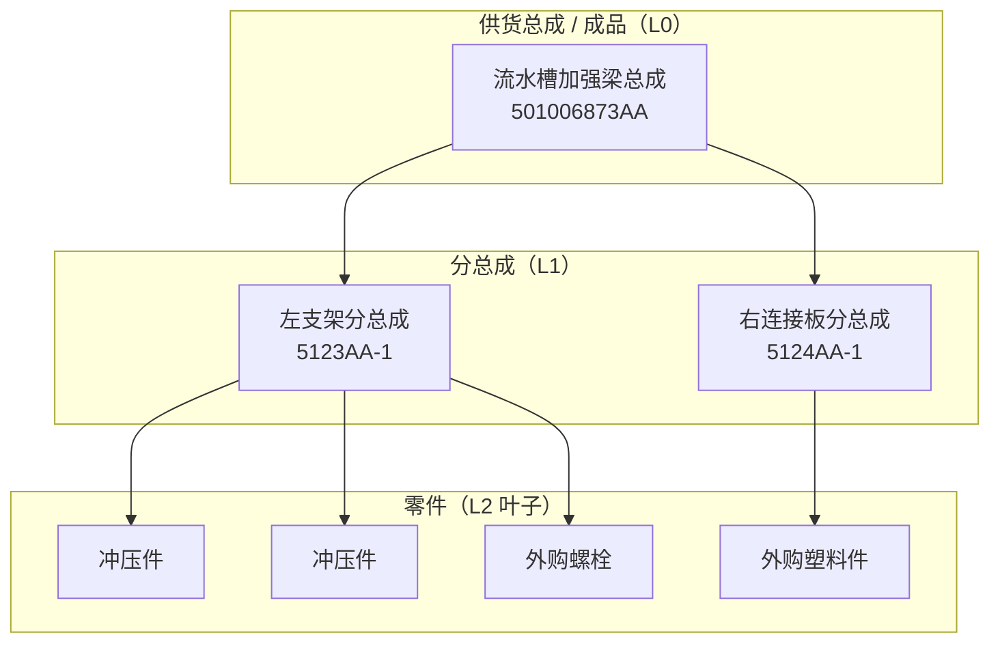
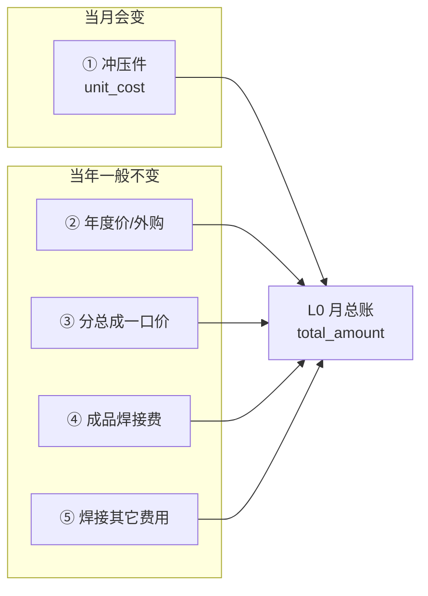
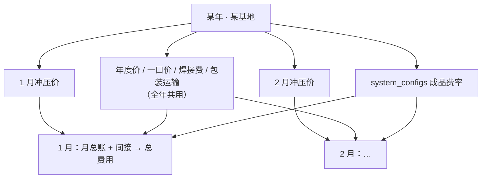
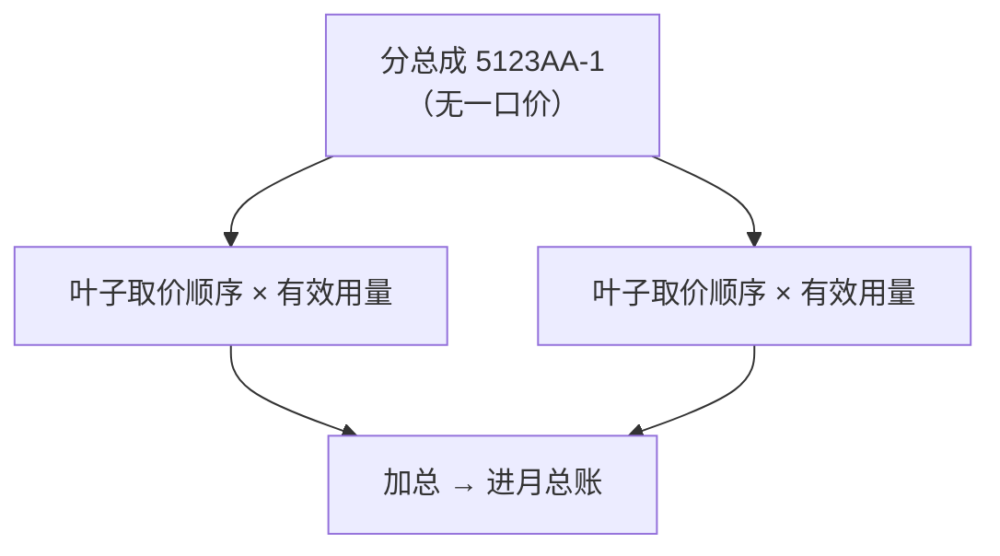
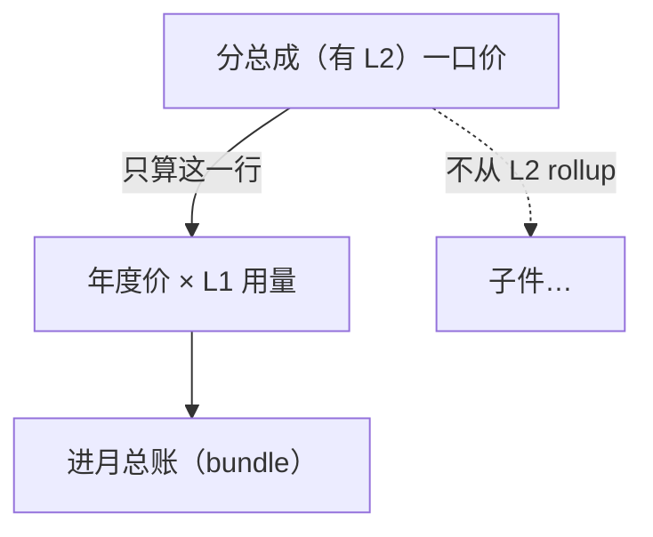
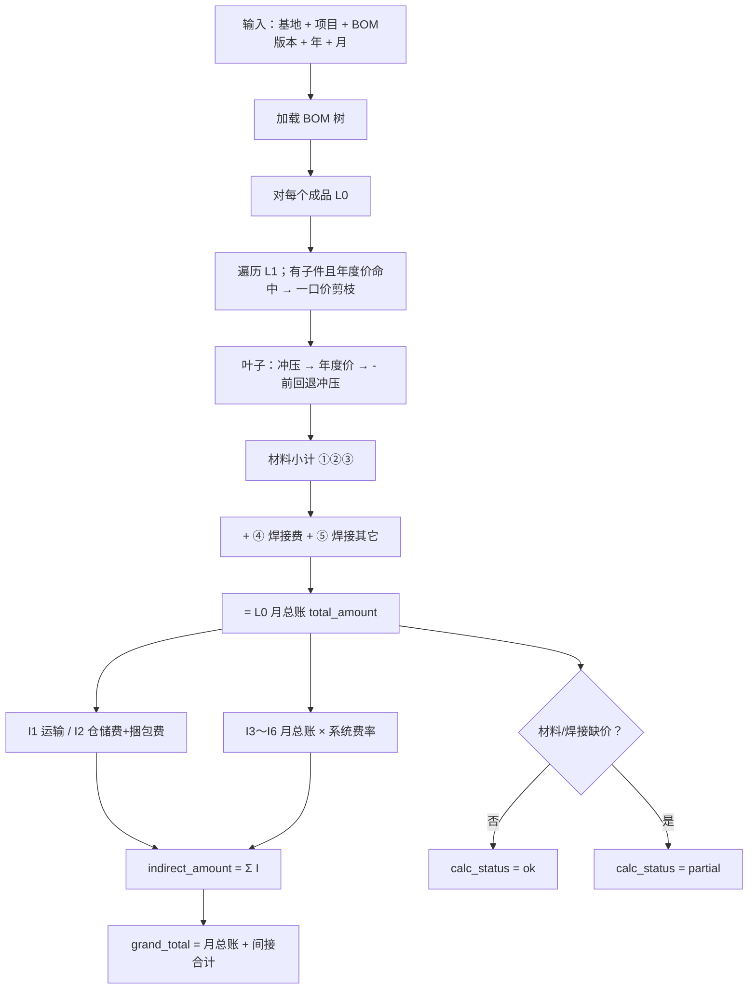

# 供货总成（L0）成品核价 — 业务与设计说明

> 面向业务、实施与新同事。说明 **如何从 BOM 结构算出每个成品的月度总成本**。  
> **状态：已上线。** 取价与汇总规则仍以本文为准；只读模拟见 `tests/costing/l0_assembly_sim.py`（青岛 T28 · 2025-01）。  
> **产品入口：** `#/l0-assembly-cost-calc`、`#/l0-assembly-cost`；API `/api/costing/l0-assembly-costs`。  
> 硬约束（分层、切片依赖）见 [architecture.md](../architecture.md)。

---

## 1. 一句话说明

**每个「供货总成（成品）」每月先算一笔 L0 月总账**（冲压 + 年度价/外购 + 一口价 + 焊接 + 焊接其它），  
再**一一单列间接费用**并汇总，  
**总费用 = 月总账 + 间接费用合计**。

> **一口价的分总成**：L1 **必须有子节点**；BOM 里仍能看到 L2，但核价时 **只认 L1 包价**，**不从 L2 rollup**。

---

## 2. 名词对照（先看这个）

| 对外说法（推荐） | 内部代号 | 含义 |
|------------------|----------|------|
| 供货总成 / **成品** | L0 | 交付客户的冲焊装配单元，核价与报价的主单位 |
| **分总成** | L1（**必须有子节点**） | 成品下还有 L2 的焊接结构；才可能一口价 |
| **零件** | L2 叶子，或 **无子节点的 L1** | 最底层：冲压件或外购件 |
| 按子件加总 | 拆散 | **有子节点** 的 L1 **无一口价**时，才对 L2 分别计价 |
| 分总成一口价 | 包价 | L1 有子节点且有价表记录：**不从 L2 rollup**，只用包价 |
| **L0 月总账** | `total_amount` | 材料 + 焊接（**不含**间接费用） |
| **间接费用** | `indirect_lines` / `indirect_amount` | 一一单列后汇总；不并入月总账 |
| **总费用** | `grand_total` | 月总账 + 间接费用合计 |
| 未算齐 | partial | 缺冲压价、缺年度价、焊接缺单价等，月总账不完整 |

---

## 3. 我们算的是谁？（结构）



- 结构数据来自现有 **BOM 材料清单**（`bom_snapshots` + `bom_nodes`）。
- 用量：子件相对父件有 `qty`；相对 **成品** 的有效用量 = 从 L0 到该节点路径上各层 `qty` **连乘**（当前模拟深度：L0→L1→L2，有效用量 = `L1.qty × L2.qty`）。

---

## 4. 两层账：月总账 + 间接费用 → 总费用

### 4.1 L0 月总账（五块积木，逻辑固定）



| 分项 | 价从哪来 | 更新频率 | 现网状态 |
|------|----------|----------|----------|
| ① 冲压件 | 当月 `stamping_part_costs.unit_cost`（只读复用，成品侧不重算） | **每月** | ✅ 已有 |
| ② 年度价/外购 | 基地 + 年度 + 零件号 → `bom_annual_part_prices.unit_price` | **每年** | ✅ 已有 |
| ③ 分总成一口价 | 同上表；L1 **有子件**且命中 → 包价剪枝 | **每年** | ✅ 同上 |
| ④ 成品焊接费 | `bom_l0_welding_fees.final_l0_welding_fee` | **每年** | ✅ 已有 |
| ⑤ 焊接其它费用 | `bom_l0_welding_fees.other_fee` | 按需 | ✅ 已有 |

```text
total_amount
  = stamping_amount + purchased_amount + bundle_amount
  + welding_amount + welding_other_fee
```

> **说明：** 报表列「年度/外购」= 命中 **年度零件价表** 的金额（含沿用件等未进当月冲压价表、改走年度价的零件），**不限于** `buy` 角色。

### 4.2 间接费用（一一单列 → 汇总 → 加进总费用）

间接费用**不并入**月总账；每项单独列出，再汇总。

| # | 分项 | 价从哪来 | 现网状态 |
|---|------|----------|----------|
| I1 | 单件运输费 | 基地 + 年度 + L0 零件号 → `bom_packaging_transport_fees.unit_transport_fee` | ✅ |
| I2 | **仓储费+捆包费** | 同上 → 结果字段 **`warehouse_bundling_fee`** ← 源 `other_fee` | ✅ |
| I3 | 财务费 | 月总账 × `system_configs.finished_finance_rate`（默认 2%） | ✅ |
| I4 | 管理费 | 月总账 × `finished_management_rate`（默认 2%） | ✅ |
| I5 | 报废费用 | 月总账 × `finished_scrap_rate`（默认 3‰） | ✅ |
| I6 | 税前利润 | 月总账 × `finished_pretax_profit_rate`（默认 2%） | ✅ |
| I7 | 检具分摊费 | 预留主数据（按 L0）；未建时 0，**计入总费用** | ⏳ |
| I8 | 器具分摊费 | 同上 | ⏳ |

```text
间接费用（一一单列）
  I1 单件运输费
  I2 仓储费+捆包费          ← 结果字段 warehouse_bundling_fee
  I3 财务费（月总账 × 财务费率）
  I4 管理费（月总账 × 管理费率）
  I5 报废费用（月总账 × 报废费率）
  I6 税前利润（月总账 × 税前利润率）
  I7 检具分摊费
  I8 器具分摊费

indirect_amount = Σ 各 I 项（含分摊）
grand_total     = total_amount + indirect_amount
```

**匹配约定（已验收）：**

| 数据 | 匹配键 |
|------|--------|
| 包装运输 I1 / I2 | **基地 + 年度 + 零件号**（不加车型） |
| 费率 I3～I6 | 读 `system_configs` 单例；基数 = 该成品当月 `total_amount` |
| 无包装运输行 | I1 / I2 记 **0**（当前模拟不因此打 partial） |

> **勿用** `packaging_transport_total` 整包并入：成品侧只取 **单件运输费** 与 **仓储费+捆包费（other_fee）** 两项单列。

### 4.3 ① 冲压件取价（与现网一致，勿拆开重算）

```text
stamping_part_costs.unit_cost   （part-cost-v9）
  = direct_cost                 ← 材料净成本 + 冲压加工费 + 模具费 + 检具费
  + finished_finance_fee        ← 直接成本 × 财务费率
  + finished_management_fee
  + finished_warehouse_packaging_fee
  + finished_pretax_profit_fee
```

成品月总账对每个冲压叶子：**`unit_cost × 相对成品有效用量`**。  
成品侧**不再**单独重算钢价或加工费。

> **注意：** 成品间接费 I3～I6 是对 **L0 月总账** 再计提；与冲压件 `unit_cost` 内已含的零件级费率是不同层级，业务上分别保留。

### 4.4 叶子取价顺序（写死）

对每个参与计价的叶子（无子件的 L1，或拆散后的 L2）：

1. **完整零件号** → 当月冲压价 `unit_cost`（须 `calc_status = success`）
2. 否则 **完整零件号** → 当年年度价 `unit_price`（`0` = 金额不计，如结构胶）
3. 仍找不到且零件号含 `-` → 取 **第一个 `-` 之前** 作为零件号，**仅回退冲压价**（不回退年度价）  
   例：`551001730AA-1` → `551001730AA`

### 4.5 Scope 与其它业务规则

- 成品核价 scope：**年 + 月 + 基地 + 项目 + BOM 版本 + 成品零件号**。
- **不认 `stamping_supplier`（冲压工厂）**：匹配冲压价用 **年 + 月 + 基地 + 项目 + 零件号**。
- 同年 1～12 月通常只有 **① 冲压** 随月变化；②③④⑤、I1/I2、费率配置按年或系统配置共用。
- **不跨基地取价**。

---

## 5. 时间与粒度



| 对象 | 粒度 |
|------|------|
| **成品核价结果** | **月**（月总账 + 间接 + 总费用） |
| 冲压零件价 | 月 |
| 年度零件价、焊接费、包装运输 | 年（按基地；包装匹配不加车型） |
| 成品费率 | 系统配置（全站单例） |

---

## 6. 分总成：两种计价（核心）

### 6.1 拆散计价（默认）

有子件的 L1 **无**年度价命中时：分总成本身不产生材料行，**对 L2 分别取价**并加总。



### 6.2 一口价（有包价）

前提：该 L1 **有子节点**，且 **基地 + 年 + L1 零件号** 命中年度价。



**规则：**

- 命中一口价 → **剪枝**，子孙不参与冲压 / 年度价加总。
- L1 **无子节点**：不是分总成；走叶子取价顺序（先冲压、再年度价、再 `-` 回退）。

---

## 7. 外购件 / 年度价覆盖谁？


**节点分类：**

| BOM 节点 | 归类 | 取价 |
|----------|------|------|
| L0 | 成品容器 | 不单独计材料；加焊接费；挂间接费用 |
| L1 **有子节点** | 分总成 | 命中年度价 → 一口价；否则拆 L2 |
| L1 **无子节点** / L2 | 叶子 | §4.4 取价顺序 |

**外购件类别（角色参考）：** `buy` / `standard` / `plastic` / `rubber` / `consumable` / `other` 等。  
**年度价也可覆盖** 未进当月冲压表的 `make` / 沿用件（业务上仍记入「年度/外购」分项）。

---

## 8. 计算流程（对每个成品、每个年月）



**防双计：**

| 规则 | 说明 |
|------|------|
| 焊接费只挂 L0 | 不按子件再加焊接 |
| 一口价 L1 截断子树 | 有子节点且命中后 **不从 L2 rollup** |
| 拆散 L1 | 有子节点且无一口价：才对 L2 计价 |
| I1/I2 不用合计字段 | 不用 `packaging_transport_total`，两项单列 |
| 间接不进月总账 | 费率与运输/仓储捆包只进 `indirect_*` / `grand_total` |

---

## 9. 逻辑表结构

### 9.1 已有（直接复用）

| 逻辑表 | 作用 |
|--------|------|
| `bom_snapshots` / `bom_nodes` | BOM 结构与用量 |
| `stamping_part_costs` | 冲压件月度 `unit_cost`（只读） |
| `bom_annual_part_prices` | 年度价 / 一口价（基地 + 年 + 零件号） |
| `bom_l0_welding_fees` | 成品焊接费 + 焊接其它 |
| `bom_packaging_transport_fees` | I1 单件运输、I2 仓储费+捆包费（`other_fee`） |
| `system_configs` | I3～I6 成品费率 |

### 9.2 待建 — 成品 **月度** 核价结果（已拍板）

前端模块目录：`static/js/features/costing/l0-assembly-cost/`（`calc` / `list`）  
API 前缀建议：`/api/costing/l0-assembly-costs`  
**不认** `stamping_supplier`。

```text
costing_l0_assembly_costs                 主表（1 成品 × 1 月）
 ├── costing_l0_assembly_cost_items       材料 / 一口价 / 被剪枝子件
 └── costing_l0_assembly_cost_indirects   间接费用一一单列（含分摊）

costing_l0_assembly_cost_calc_logs        可选：计算任务日志
```

#### 拍板结论

| # | 议题 | 决定 |
|---|------|------|
| 1 | I2 字段名 | **`warehouse_bundling_fee`**（业务名：仓储费+捆包费；源表仍为 `bom_packaging_transport_fees.other_fee`） |
| 2 | 检具/器具分摊 | **要**：入库，并 **计入 `grand_total`**（上游未就绪时金额为 0） |
| 3 | 一口价剪枝的 L2 | **要**落明细：`cost_source = skipped_by_bundle`（对账 / 导出可展示「未计价」） |

#### 主表 `costing_l0_assembly_costs`

**唯一约束：** `(year, month, location, vehicle_model, bom_version, part_number)`

| 分组 | 字段 | 类型建议 | 说明 |
|------|------|----------|------|
| Scope | `year`, `month` | int | |
| | `location`, `vehicle_model`, `bom_version` | varchar | |
| | `part_number`, `part_name` | varchar | L0 快照 |
| | `supply_qty` | Numeric(12,4) | 单车用量，默认 1 |
| | `bom_snapshot_id` | int? | 可选 |
| | `sketch_url` | varchar? | 导出零件图册 |
| 月总账 | `stamping_amount` | Numeric(14,4) | ① |
| | `purchased_amount` | Numeric(14,4) | ② |
| | `bundle_amount` | Numeric(14,4) | ③ |
| | `material_amount` | Numeric(14,4) | =①+②+③ |
| | `welding_amount` | Numeric(14,4) | ④ |
| | `welding_other_fee` | Numeric(14,4) | ⑤（焊接其它；勿与包装 other 混名） |
| | **`total_amount`** | Numeric(14,4) | **L0 月总账**（不含间接） |
| 间接宽列 | `unit_transport_fee` | Numeric(14,4) | I1 |
| | **`warehouse_bundling_fee`** | Numeric(14,4) | I2 仓储费+捆包费 |
| | `finished_finance_fee` | Numeric(14,4) | I3 |
| | `finished_management_fee` | Numeric(14,4) | I4 |
| | `finished_scrap_fee` | Numeric(14,4) | I5 |
| | `finished_pretax_profit_fee` | Numeric(14,4) | I6 |
| | `gauge_alloc_fee` | Numeric(14,4) | 检具分摊（预留上游；暂 0） |
| | `fixture_alloc_fee` | Numeric(14,4) | 器具分摊（预留上游；暂 0） |
| | `allocation_fee_total` | Numeric(14,4) | = 检具 + 器具 |
| | **`indirect_amount`** | Numeric(14,4) | Σ 全部间接项（含分摊） |
| | **`grand_total`** | Numeric(14,4) | = `total_amount` + `indirect_amount` |
| 费率快照 | `finance_rate` 等四个 | Numeric(8,6) | 算时拷贝自 `system_configs` |
| 焊接溯源 | `welding_fee_id` | int? | → `bom_l0_welding_fees.id` |
| | `welding_summary` | text? | |
| 状态 | `calc_status` | varchar | `ok` / `partial` / `failed` / `processing` |
| | `missing_leaf_count` | int | |
| | `formula_version` | varchar | 如 `l0-assembly-v1` |
| | `calculated_at` | datetime | |
| 审核 | `audit_status` + 审核/反审核字段 | | 已审禁止覆盖 |
| 审计 | `AuditUserMixin` | | |
| | `remark` | text? | |

**金额关系（写死）：**

```text
material_amount     = stamping + purchased + bundle
total_amount        = material + welding + welding_other
allocation_fee_total = gauge_alloc_fee + fixture_alloc_fee

indirect_amount =
    unit_transport_fee + warehouse_bundling_fee
  + finished_finance_fee + finished_management_fee
  + finished_scrap_fee + finished_pretax_profit_fee
  + allocation_fee_total

grand_total = total_amount + indirect_amount
```

#### 材料明细 `costing_l0_assembly_cost_items`

| 字段 | 说明 |
|------|------|
| `assembly_cost_id` | FK，级联删 |
| `level_label` | `L1-leaf` / `L2` / `L1-bundle` |
| `bom_node_id` | 可选 |
| `part_number`, `part_name` | |
| `node_role`, `supply_type` | 供货类型快照 |
| `cost_source` | `stamping` / `annual` / `bundle` / **`skipped_by_bundle`** / `missing` |
| `match_hint` | 如 `dash_fallback:…`；剪枝行可记父 L1 零件号 |
| `unit_price`, `effective_qty`, `line_amount` | 剪枝行：单价/金额为 **0**（或 NULL），仍保留 qty 便于对账 |
| `sort_no` | |

**`skipped_by_bundle`：** L1 一口价命中后，其下 L2 **仍写入明细**，不参与 `stamping/purchased` 加总，供列表对账与「焊接总成」导出展示。

#### 间接明细 `costing_l0_assembly_cost_indirects`

| 字段 | 说明 |
|------|------|
| `assembly_cost_id` | FK |
| `code` | 见下表 |
| `label` | 展示名 |
| `amount` | |
| `rate`, `base_amount` | 费率项有值；定额/分摊项为 NULL |
| `sort_no` | |

**唯一：** `(assembly_cost_id, code)`；金额为 0 也保留行。

| sort | code | label |
|------|------|-------|
| 1 | `unit_transport_fee` | 单件运输费 |
| 2 | `warehouse_bundling_fee` | 仓储费+捆包费 |
| 3 | `finished_finance_fee` | 财务费 |
| 4 | `finished_management_fee` | 管理费 |
| 5 | `finished_scrap_fee` | 报废费用 |
| 6 | `finished_pretax_profit_fee` | 税前利润 |
| 7 | `gauge_alloc_fee` | 检具分摊费 |
| 8 | `fixture_alloc_fee` | 器具分摊费 |

> 主表宽列与间接子表同算同写；列表读主表，对账/导出读子表。

#### 覆盖与审核

- 同唯一键重算：先删两项明细，再 upsert 主表。
- `audit_status = approved` → 禁止覆盖/删除，须先反审核。
- 包装运输缺失 → I1/I2 = 0，不因此 partial；材料/焊接缺价 → `partial`。
- 检具/器具上游未建：分摊金额写 **0**，行仍落间接子表，**公式仍计入 `grand_total`**（加 0）。

### 9.3 验收样例（青岛 / T28 / 2025-01 · `501006873AA`）

| 层级 | 金额 |
|------|------|
| L0 月总账 | 18.7875 |
| I1 单件运输费 | 0.7600 |
| I2 仓储费+捆包费（`warehouse_bundling_fee`） | 0.3872 |
| I3～I6 费率 | 0.3758 ×3 + 0.0564 |
| 检具/器具分摊 | 0（预留） |
| 间接合计 | 2.3310 |
| **总费用** | **21.1185** |

同 scope 全量模拟（27 个 L0）：月总账合计 1265.3048，间接合计 159.2668，总费用合计 1424.5716，**27/27 ok**（当时分摊为 0）。

---

## 10. 与现网 L0 焊接费的分工

| | L0 焊接费（已实现） | 成品月核价（本文） |
|--|---------------------|---------------------|
| 算什么 | 仅焊接工序费 | **成品全成本**（月总账 + 间接 → 总费用） |
| 粒度 | 年 + 基地 + 项目 + BOM 版本 | 上述 + **月** |
| 关系 | `welding_amount` **引用** `final_l0_welding_fee` | 汇总主表 |

两模块并存：焊接费可单独算、单独审；成品核价将其作为月总账分项之一。

---

## 11. 上游依赖与实施状态

```text
1. BOM 材料清单入库                                              ✅
2. 冲压工艺 + 钢价联动 + 加工费 → 月度冲压零件价（unit_cost）      ✅
3. 年度零件价 bom_annual_part_prices                             ✅
4. 焊接工艺拆解 + L0 焊接费                                      ✅
5. 包装运输费 bom_packaging_transport_fees（I1/I2）               ✅
6. system_configs 成品费率（I3～I6）                              ✅
7. 规则只读模拟验收（tests/costing/l0_assembly_sim.py）           ✅
8. 成品月核价产品落地（结果表 / API / 页面）                      ⏳ 待建
```

材料或焊接缺价 → `calc_status = partial`（与现网 L0 焊接费「缺单价」同一思路）。

---

## 12. 边界与前提（避免误解）

| topic | 说明 |
|--------|------|
| 年度价 12 个月不变 | 外购 / L1 / 焊接 / 包装运输无「生效月」时，同年各月共用 |
| 一口价 vs BOM 子件 | 结构可展示 L2；核价以价表包价为准 |
| 同号多分支 | 同一零件号在不同分支分别 rollup 后 **相加** |
| **不认冲压工厂** | 成品侧忽略 `stamping_supplier` |
| 勿重复计冲压加工费 | ① 已含在 `unit_cost`；④ 仅为 **成品焊接费** |
| 间接 ≠ 月总账 | 运输 / 仓储捆包 / 费率只进间接与总费用 |
| I2 库字段 | **`warehouse_bundling_fee`**；源表 `bom_packaging_transport_fees.other_fee` |
| 检具/器具分摊 | 计入间接与 `grand_total`；上游未建时为 0 |
| 一口价剪枝 L2 | 明细落 `skipped_by_bundle`，不计入材料小计 |
| 年度价 = 0 | 金额不计（如结构胶），不等于缺价 |

---

## 13. 切片归属（实现时）

| 内容 | 切片 |
|------|------|
| 年度价 / 包装运输 / 焊接费主数据 | `bom` |
| 成品费率 | `settings`（`system_configs`） |
| 成品月核价编排与结果 | `costing`（下游组合 `bom` + `stamping` + `settings`） |

依赖方向：**costing → bom / stamping / settings**，禁止反向。

---

## 14. 相关文档与代码

| 文档 / 代码 | 说明 |
|-------------|------|
| [architecture.md](../architecture.md) | 分层与切片 |
| [api-type-safety.md](../api-type-safety.md) | API / 金额 Decimal 约定 |
| [bom-annual-part-prices-design.md](../bom/bom-annual-part-prices-design.md) | 年度零件价 |
| `app/models/costing/stamping_part_cost.py` | 冲压零件价 |
| `app/models/bom/packaging_transport_fee.py` | 包装运输（I1/I2） |
| `app/models/settings/system_config.py` | 成品费率（I3～I6） |
| `app/models/bom/l0_welding_fee.py` | L0 焊接费 |
| `tests/costing/l0_assembly_sim.py` | 只读模拟（规则真相源） |
| `tests/costing/test_l0_assembly_simulation.py` | 单元 + 青岛集成验收 |

---

## 修订记录

| 日期 | 说明 |
|------|------|
| 2026-08-19 | 初稿：成品月核价、五块积木、L1 包价不 rollup、表结构逻辑、示意图 |
| 2026-08-20 | 校对冲压分项：取 `unit_cost`；不认冲压工厂；一口价须有子节点 |
| 2026-08-20 | 外购与 L1 一口价合并为 `bom_annual_part_prices` |
| 2026-08-20 | **与模拟验收对齐**：月总账 / 间接（I1～I6，I2=仓储费+捆包费）/ 总费用；叶子取价顺序与 `-` 回退；上游表状态与结果表字段；样例金额 |
| 2026-08-20 | **库表拍板**：I2=`warehouse_bundling_fee`；检具/器具分摊计入 `grand_total`；明细保留 `skipped_by_bundle`；模块名 `l0-assembly-cost` |
