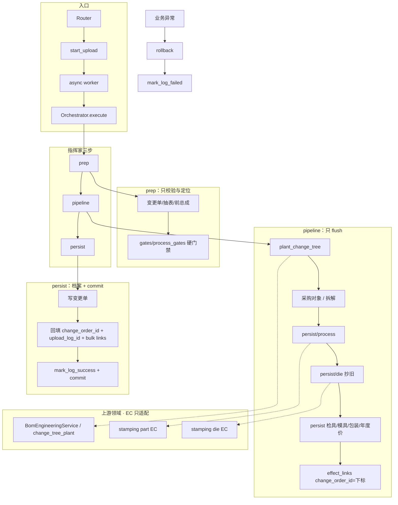

# 工程变更

跨切片能力（BOM / 冲压 / 核价）。**工程变更上传、列表、回滚已落地**（`app/services/engineering_change/`）。  
有效期与核价按月见 [bom-process-die-effective-period-design.md](bom-process-die-effective-period-design.md)。工程变更门禁从严：一本一个项目号；材料清单与确认表版本必须同一字；生效月须在项目期内；必须先有 SOP 采购对象清单头；版本与清单头不得凑合。

> 2–4 年后敢改：先读本节，再下钻长设计稿。长稿与代码冲突时以**代码 + 本节**为准。

---

## 领域背景

结构件企业按月结账。顾客改图会给**新零件号**（现场常见末两位字母进一位，如 AA→AB）。工程变更一次带齐；**系统只照抄工程变更单格子里的号，禁止自己把 AA 加成 AB、把 AB 加成 AC**：

| 表 | 作用 |
|----|------|
| 工程变更单 | 生效年月 + 前后总成 + 总成名称 + 变更类型；**新旧号以这张表为准** |
| 车身件材料清单 | 新树骨架（可含「此件不装」剔除行）；总成列 = 变更后总成；中间分总成新号以本表为准 |
| 冲压工艺确认表 | 新号工艺（号须等于变更后零件）；改图缺新号拒收；**零件简图只画在这张表**，导入后抄到新号工艺行和（若逻辑建立了）新号布点 |
| 模具布点 | **工程变更不填、不解析。** 改图有旧布点则从库逻辑建立新号；简图从工艺确认表抄过去 |

现场现实：一个项目多级供应商（海众/振华各一套台账）、左右总成共用一级件、少零件（「此件不装」）比整树重导更常见。工程变更是**时间轴上的切点**，不是再拍一份全量快照。图变了就是另一件物料：换零件号（号写在变更单上），未来 ERP 出入库也按新号办；交货总成 / 分总成必须有内部号，交货总成必须有总成图，材料清单里写出的一级零件必须有单件图示。

---

## 架构决策（ADR）

### 为什么图变了必须换零件号？

奇瑞（客户方）设计图改了，它就是另一件存货，不是同一件改个字。一个交货总成只要碰上五种场景之一（总成改图 / 一级改图 / 二级改图 / 此件不装 / 增加零件），**总成图必然变了，交货总成零件号必然换**；完成停止没有新图、没有新号。核价按月各算各的；未来 ERP 入库、出库、库存按两个物料号办。所以是 **旧号到期、新号启用**，禁止在旧节点上改档案。新号以工程变更单为准（写成 AB 用 AB，写成 AC 用 AC），系统不推算末两位。出入库主键是 **零件号**。内部号是厂内 ERP 物料码：总成 / 分总成必填，给人建档联查，不是出入库主键。总成必须有图。细则见 [part-number-revision-design.md](part-number-revision-design.md) §1、§3。

### 为什么用时间轴（`as_of_month`）而不是快照？

核价按「某年某月仍有效」取树/工艺/布点。改图是 **旧的到期、新的启用**：旧树/旧工艺行失效写到生效月的前一月（**不删行**），新树/新工艺行从生效月起用。前一月旧账仍要看见 AA。不要说作废。若每次变更复制全量快照，旧月重算要绑「哪次变更编号」，与现网按月结账、与投产 UNIQUE 都不合。

### 为什么新旧号只认工程变更单，不收口到字母进一位？

种树、工艺/布点停号、采购对象抄确认，旧号和新号都必须是变更单十列（及材料清单已经写出的中间分总成）里的字。禁止按茎猜前驱、禁止把 AA 加成 AB / 把 AB 加成 AC。工程变更门禁与种树 **只**做整号相等。`122AA` 与 `122AA-1` 是两个号，对不上就不要自己配对。

「此件不装」双信号（用量=0 **且** 备注含固定句）同样只认 `is_not_install_row`：工程变更门禁与种树必须同一判定，禁止各写一份。

### 其它不变量（改前必守）

| 项 | 规则 |
|----|------|
| 硬门禁 | 变更单 + 材料清单 + 工艺确认表。材料清单总成列必须等于变更后总成；改图层必须等于变更后零件。缺新号 / 多新号 / 旧号仍挂其它有效总成 → 拒收 |
| 工程变更不读布点表 | 不要「零件汇总」。模具 **逻辑建立**：改图有旧布点则从库里变更前零件整行抄到变更后零件。新号布点简图从冲压工艺确认表抄，不从旧布点、不从 Excel 抽 |
| 抄检具/模具费/包装/年度价 | 改图：旧号有检具费生效档或 `year≥生效年` 模具费结果 → 抄到新号。种新树：旧交货总成 `year≥生效年` 包装整行抄到新总成；种树 remap 换号则年度价 `year≥生效年` 抄到新号。无则跳过；不读 Excel、非硬门禁。回滚删本次新行（先年度价/包装/模具费/检具费，再布点）；旧行保留 |
| 种树 | 只经 `persist/tree.py` → BomEngineeringService；到期经 `expire_l0_tree`（写失效月，不删行）。改图以旧树为底 **启用**新树，**整条链**换号：总成/改图层用变更单，中间分总成用材料清单已写出的号，**禁止自己进一位**；没改的零件原号带走 |
| `change_order_id` 占位 | 管线里 `change_order_id` 是变更单行下标；persist 插变更单后再回填真实 id。勿提前 flush |
| SOP 不改 | Parser / UNIQUE / 引擎发现键 / 投产整包覆盖路径不为本切片去改 |
| 依赖方向 | EC → 上游 Service；上游不得 import EC |

### 为什么引擎仍调 generate，却可能报「请工程变更重传」？

核价引擎缺焊接拆解或采购对象时 **同进程** 调现网 `generate`（`runners.run_annual_item`），与生成页 **同一把钥匙** `snapshot_blocks_full_generate`（非 SOP 生效月或已失效 L0 → 拦）。

- 可整包 → 自动生成，再算焊接费 / 进总成  
- 拦住 → generate 抛 `EC_GATE_FULL_GENERATE`，引擎按步骤映射为 `EC_GATE_ENGINE_BREAKDOWN` 或 `EC_GATE_ENGINE_PROCUREMENT`  

**禁止**在引擎 runner 写死「一律失败」：那会把从未工程变更、仅 SOP 的项目也掐死。四年后改门禁只动 `snapshot_blocks_full_generate` / generate，不要在 costing 再复制一套判定。

---

## 核心链路图



回滚：删除列表任意一条 = `list/rollback_service.py` 按 `effect_links` **逆序**恢复业务对象，再 **物理删除** 本本上传头 / 变更单 / 效果链接。未知 `effect_kind` 拒收。存档 Excel 保留。逆序时先删本次新插的年度价/包装/模具费/检具费，再滚布点（避免布点 RESTRICT）。只删链接 `after_id`，禁止按零件号扫库。

---

## 错误码字典

常量定义在 `app/common/engineering_change_gates.py`。前端/测试按**文案全文**匹配即可。

| 常量 | 含义 | 排查 |
|------|------|------|
| `EC_EFFECTIVE_TOO_EARLY` | 工程变更生效月 ≤ 旧总成生效月 | 上传页年月是否晚于变更前 L0 生效月；切点必须「往后切」 |
| `EC_BEFORE_ASSEMBLY_INVALID` | 找不到这个变更前总成，或者这个月已经不用了 | 上传页年月对不对；这个号有没有已经导入、有没有被更早一次变更停掉 |
| `EC_AFTER_ASSEMBLY_EXISTS` | 变更后总成系统里已经有了 | 不要把已经有的号再当变更后总成传一次 |
| `EC_AFTER_ASSEMBLY_BUSY` | 这个变更后总成正在导入，请等这次完成 | 等并行任务结束或查上传记录 |
| `EC_NOT_INSTALL_SIGNAL` | 此件不装必须用量 0 且备注含「此件不装」 | 用量和备注两格都要写对 |
| `EC_PROCESS_MISSING_NEW` | 冲压工艺确认表少了这个新零件号 | 材料清单换了号或新加了冲压件，确认表也要写出这一号 |
| `EC_PROCESS_EXTRA_NEW` | 冲压工艺确认表多了材料清单没有的号 | 删多余工艺行，或把这个号补进材料清单 |
| `EC_PROCESS_SHARED_OLD` | 这个旧号还装在别的总成上，不能按改图停掉 | 左右总成共用件：先改另一侧或走增加零件。只在旧号当月仍有工艺时 |
| `EC_QTY_CHANGED` | 用量与变更前总成不一致 | 本树没有增加零件时不能改用量；有增加零件已是新总成，不拒 |
| `EC_PART_SKETCH_REQUIRED` | 材料清单里的一级/二级零件没有单件图示 | 在「单件图示」列贴图，或在冲压工艺确认表给出该号简图（系统会抄到材料清单图目录）；总成图示按合并总成只需一张；分总成本层不要求；此件不装不要求 |
| `EC_SHEET_REQUIRED` | 缺工程变更单 / 车身件材料清单 / 冲压工艺确认表 | 三张表缺一不可；不要「零件汇总」 |
| `EC_EFFECTIVE_MISMATCH` | 生效年月与上传页不一致 | 上传页的年、月要和工程变更单一致；一次只能一个变更年月 |
| `EC_PROJECT_MISMATCH` | 一本只能一个项目号 | 对照上传页、工程变更单、材料清单项目代号、确认表标题里的项目 |
| `EC_PROCUREMENT_LIST_REQUIRED` | 还没有采购对象清单头 | 先到焊接工程生成；完成停止也不例外 |
| `EC_BOM_PROCESS_VERSION_MISMATCH` | 两张表版本不是同一个字 | 材料清单第 2 行与确认表表头必须写成一样 |
| `EC_CHANGE_ORDER_*` | 变更单行数、类型、填法、同一个总成写了多次 | 类型只准四句：完成停止、改图、增加零件、此件不装；一个总成改了好几处请把总成格子上下合并 |
| `EC_ROLLBACK_BLOCKED` | 不能删本次 | 其后还有未回滚变更，或采购对象已审未反审 |
| `EC_ROLLBACK_REFERENCED` | 不能删本次 | 加工费/模具费/焊接费等仍引用本次变更产生的零件或布点 |
| `EC_GATE_FULL_GENERATE` | 禁止整包 generate | 已有设变树（或失效 L0）；请走工程变更重传 |
| `EC_GATE_ENGINE_BREAKDOWN` | 引擎拆解补算被同一把钥匙拦住 | 引擎已调 generate；`FULL_GENERATE` 映射为此文案。查是否工程变更未抄齐拆解 |
| `EC_GATE_ENGINE_PROCUREMENT` | 引擎采购对象补算被同一把钥匙拦住 | 引擎已调 generate；查是否工程变更未插齐本树对象行 |

业务失败时 worker：**先 `rollback`，再 `mark_log_failed`**——否则半截 flush 会跟 failed 日志一起落库。

---

## 本地跑测试指南

```powershell
# 起本地服务（按需）
python -X utf8 .\run_dev.py

# 本切片单测
python -X utf8 -m pytest tests/engineering_change -q

# 全库（更慢）
python -X utf8 -m pytest -q
```

PowerShell 禁止用 `&&` 串联；用 `;` 或分行。

**Mypy**：改完 Python 后若 CI/本地 mypy 报类型错，先看报错文件是否在本次改动路径；本切片注释/文档改动不应引入新类型问题。缓存脏时删 `.mypy_cache` 再跑项目既有 mypy 命令（见仓库根或 CI 配置）。不要为「消 mypy」去改业务语义。

---

## 入口与代码地图

```
Router → EngineeringChangeUploadService.start_upload
      → async worker → EngineeringChangeOrchestrator.execute
      → prepare → pipeline → persist
```

| 路径 | 职责 |
|------|------|
| `upload/upload_service.py` | 门面：下模板、点上传 |
| `upload/start_upload.py` | 入队壳 + 业务失败 rollback |
| `upload/template_builder.py` | 下载模板（与导入执行无关） |
| `upload/orchestrator/` | 指挥家：prep / pipeline / persist |
| `upload/gates/` | 校验帮手：变更单 / 树 / 工艺 / 切清单 |
| `upload/persist/` | 写入适配（树 / 对象 / 拆解 / 工艺 / 布点 / 检具费 / 模具费 / 包装 / 年度价）；只 flush |
| `list/query_service.py` | 工程变更单列表 / 详情 |
| `list/rollback_service.py` | `EFFECT_*` 回滚（含 `gauge_fee` / `die_fee` / `packaging_fee` / `annual_part_price`） |
| `app/common/engineering_change_gates.py` | 文案常量 + 整包门禁谓词（新旧号整号比较，不 bump） |

上游内核（勿把业务搬回 EC）：

- `app/services/bom/bom/change_tree_plant/`
- `app/services/stamping/part/engineering/change.py`
- `app/services/stamping/die/engineering/change.py`
- `app/services/stamping/gauge_fee/engineering/change.py`
- `app/services/stamping/die_fee/engineering/change.py`
- `app/services/bom/packaging_transport_fee/engineering_change.py`
- `app/services/bom/annual_part_price/engineering_change.py`

---

## 设计稿与样表

| 文档 | 说明 |
|------|------|
| [part-number-revision-design.md](part-number-revision-design.md) | 领域契约（样表即规格、§4 写入、§8 产品）；**落地状态以本节为准** |
| [bom-process-die-effective-period-design.md](bom-process-die-effective-period-design.md) | 交货总成 / 工艺 / 布点生失效（已落地） |
| [t28-2025-07-import-bundle-test-design.md](t28-2025-07-import-bundle-test-design.md) | 青岛 T28 测试样本（对照一本可整本上传；另有五份单种改法夹具） |
| [t13j-2025-05-import-bundle-test-design.md](t13j-2025-05-import-bundle-test-design.md) | 芜湖 T13J · 2025-05 测试样本（对照一本 + 五份夹具） |
| [samples/engineering-change-t13j-3086ab.xlsx](samples/engineering-change-t13j-3086ab.xlsx) | T13J 3086AA→AB 样表（单总成演示） |
| [samples/t28-2025-07-import-bundle.xlsx](samples/t28-2025-07-import-bundle.xlsx) | 下载模板 / 对照一本：T28 五种填法 |
| [samples/t28-2025-07-stop.xlsx](samples/t28-2025-07-stop.xlsx) 等五份 | 单种改法夹具（完成停止 / 一级改图 / 二级改图 / 此件不装 / 增加零件） |
| [samples/build_t28_2025_07_import_bundles.py](samples/build_t28_2025_07_import_bundles.py) | 写出对照一本 + 五种改法各一份 |
| [samples/t13j-2025-05-import-bundle.xlsx](samples/t13j-2025-05-import-bundle.xlsx) | 芜湖 T13J 对照一本：五种填法 |
| [samples/t13j-2025-05-stop.xlsx](samples/t13j-2025-05-stop.xlsx) 等五份 | T13J 单种改法夹具 |
| [samples/build_t13j_2025_05_import_bundles.py](samples/build_t13j_2025_05_import_bundles.py) | 写出 T13J 对照一本 + 五种改法各一份 |

一口价年内分段不在本目录，见 [effective-period-design.md](../costing/effective-period-design.md)。
