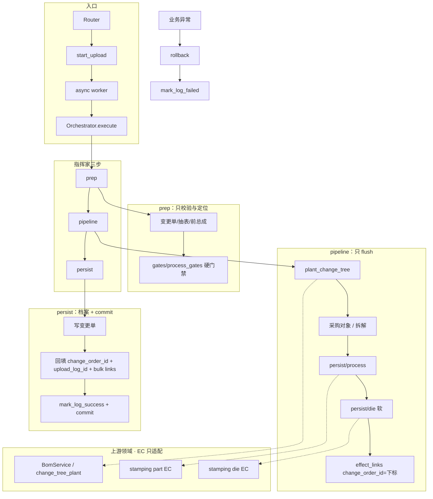

# 工程变更

跨切片能力（BOM / 冲压 / 核价）。**合册上传、列表、回滚已落地**（`app/services/engineering_change/`）。  
有效期与核价按月见 [bom-process-die-effective-period-design.md](bom-process-die-effective-period-design.md)。

> 2–4 年后敢改：先读本节，再下钻长设计稿。长稿与代码冲突时以**代码 + 本节**为准。

---

## 领域背景

汽车冲压厂按月结账。零件号末两位字母是**版本**：AA→AB 改图，用量不变、结构变号。合册一次带齐：

| 表 | 作用 |
|----|------|
| 工程变更单 | 生效年月 + 前后总成 + 总成名称 + 变更类型 |
| 车身件材料清单 | 新树骨架（可含「此件不装」剔除行） |
| 冲压工艺确认表 | 新号工艺；改图缺新号拒收 |
| 模具布点（可选） | 摊模具用；青岛 T28 投产可无表 |

现场现实：一个项目多级供应商（海众/振华各一套台账）、左右总成共用一级件、少零件（「此件不装」）比整树重导更常见。合册是**时间轴上的切点**，不是再拍一份全量快照。图变了就是另一件物料：零件号进一位，未来 ERP 出入库也按新号办；交货总成 / 分总成必须有内部号，交货总成必须有图。

---

## 架构决策（ADR）

### 为什么图变了必须换零件号？

奇瑞（客户方）设计图改了，它就是另一件存货，不是同一件改个字。核价按月各算各的；未来 ERP 入库、出库、库存也按两个物料号办。所以改图是 **旧号到期、新号启用**（AA→AB），禁止在旧节点上改档案。出入库主键是 **零件号**。内部号是厂内 ERP 物料码：总成 / 分总成必填，给人建档联查，不是出入库主键。总成必须有图。细则见 [part-number-revision-design.md](part-number-revision-design.md) §3。

### 为什么用时间轴（`as_of_month`）而不是快照？

核价按「某年某月仍有效」取树/工艺/布点。改图是 **旧的到期、新的启用**：旧树/旧工艺行失效写到生效月的前一月（**不删行**），新树/新工艺行从生效月起用。前一月旧账仍要看见 AA。不要说作废。若每次变更复制全量快照，旧月重算要绑「哪次变更编号」，与现网按月结账、与投产 UNIQUE 都不合。

### 为什么字母版本和「此件不装」收口到 `common/engineering_change_gates`？

AA→AB 的识别、bump、找前驱被 BOM 种树、工艺/布点停号、合册门禁共用。散落各切片会「工艺认 AA→AB、布点认别的规则」。**只**用 `letter_version_*` / `bump_letter_version` / `find_letter_predecessor_number`。分总成号（`122AA-1`）的字母版本在 `-1` 前面，茎含 `-1`，不得把 `122AA` 和 `122AA-1` 当成同一个号。

「此件不装」双信号（用量=0 **且** 备注含固定句）同样只认 `is_not_install_row`：合册门禁与种树必须同一判定，禁止各写一份。

### 其它不变量（改前必守）

| 项 | 规则 |
|----|------|
| 硬门禁 | 变更单 + 材料清单 + 工艺确认表。缺新号 / 多新号 / 旧号仍挂其它有效总成 → 拒收 |
| 软门禁 | 模具「零件汇总」可缺、可空、解析失败可跳过（warning） |
| 种树 | 只经 `persist/tree.py` → BomService；到期经 `expire_l0_tree`（写失效月，不删行）。改图以旧树为底 **启用**新树，**整条链**换号（总成 + 中间分总成 + 改图层），没改的零件原号带走 |
| `change_order_id` 占位 | 管线里 `change_order_id` 是变更单行下标；persist 插变更单后再回填真实 id。勿提前 flush |
| SOP 不改 | Parser / UNIQUE / 引擎发现键 / 投产整包覆盖路径不为本切片去改 |
| 依赖方向 | EC → 上游 Service；上游不得 import EC |

---

## 核心链路图



回滚：删除列表任意一条 = `list/rollback_service.py` 按 `effect_links` **逆序**恢复业务对象，再 **物理删除** 本本上传头 / 变更单 / 效果链接。未知 `effect_kind` 拒收。存档 Excel 保留。

---

## 错误码字典

常量定义在 `app/common/engineering_change_gates.py`。前端/测试按**文案全文**匹配即可。

| 常量 | 含义 | 排查 |
|------|------|------|
| `EC_EFFECTIVE_TOO_EARLY` | 合册生效月 ≤ 旧总成生效月 | 上传页年月是否晚于变更前 L0 生效月；切点必须「往后切」 |
| `EC_SEQ_MISMATCH` | 材料清单序号 ≠ 投产序号 | 对照投产清单同厂同号 `seq_no`；合册勿改序号语义 |
| `EC_BEFORE_ASSEMBLY_INVALID` | 变更前总成无效/已失效 | 切点**前一月**旧树须仍有效；检查失效月是否已被更早合册切掉 |
| `EC_AFTER_ASSEMBLY_EXISTS` | 变更后总成已存在 | 库里已有同号有效 L0；勿重复传 AB |
| `EC_AFTER_ASSEMBLY_BUSY` | 同一后总成正在导入 | 等并行任务结束或查上传日志 |
| `EC_NOT_INSTALL_SIGNAL` | 「此件不装」双信号不全 | 必须用量=0 **且**备注含「此件不装」；单边拒收防呆 |
| `EC_PROCESS_MISSING_NEW` | 工艺表缺新号 | 材料清单换号/新加且旧号有工艺时，确认表必须有对应新号 |
| `EC_PROCESS_EXTRA_NEW` | 工艺表多出材料清单没有的新号 | 删多余工艺行或补材料清单 |
| `EC_PROCESS_SHARED_OLD` | 旧号仍挂其它有效总成 | 左右总成共用件：先改另一侧或走增加零件，勿只停一侧 AA |
| `EC_QTY_CHANGED` | 用量与变更前不一致 | 工程变更不改用量；用量变走投产/别路径 |
| `EC_SHEET_REQUIRED` | 缺工程变更单/材料清单/工艺表 | 合册三硬表缺一拒收；布点不是硬表 |
| `EC_EFFECTIVE_MISMATCH` | 变更单生效年月 ≠ 上传页 | 对齐上传表单与变更单十列 |
| `EC_PROJECT_MISMATCH` / `EC_CUSTOMER_MISMATCH` | 项目/奇瑞（客户方）不一致 | 对照投产清单头与变更单 |
| `EC_CHANGE_ORDER_*` | 变更单行数/类型/十列 | 类型只准四句：完成停止、改图、增加零件、此件不装 |
| `EC_ROLLBACK_BLOCKED` | 不能删本次 | 其后还有未回滚变更，或采购对象已审未反审 |
| `EC_GATE_FULL_GENERATE` | 禁止整包 generate | 已有设变树；请走合册重传 |
| `EC_GATE_ENGINE_BREAKDOWN` | 引擎缺新树拆解 | 合册未带齐拆解或未落库 |

业务失败时 worker：**先 `rollback`，再 `mark_log_failed`**——否则半截 flush 会跟 failed 日志一起落库。

---

## 本地跑测试指南

```powershell
# 起本地服务（按需）
python -X utf8 .\run_dev.py

# 本切片单测
python -X utf8 -m pytest tests/engineering_change -q

# 全库（更慢）
python -X utf8 -m pytest -q
```

PowerShell 禁止用 `&&` 串联；用 `;` 或分行。

**Mypy**：改完 Python 后若 CI/本地 mypy 报类型错，先看报错文件是否在本次改动路径；本切片注释/文档改动不应引入新类型问题。缓存脏时删 `.mypy_cache` 再跑项目既有 mypy 命令（见仓库根或 CI 配置）。不要为「消 mypy」去改业务语义。

---

## 入口与代码地图

```
Router → EngineeringChangeUploadService.start_upload
      → async worker → EngineeringChangeOrchestrator.execute
      → prepare → pipeline → persist
```

| 路径 | 职责 |
|------|------|
| `upload/upload_service.py` | 门面：下模板、点上传 |
| `upload/start_upload.py` | 入队壳 + 业务失败 rollback |
| `upload/template_builder.py` | 下载模板（与导入执行无关） |
| `upload/orchestrator/` | 指挥家：prep / pipeline / persist |
| `upload/gates/` | 校验帮手：变更单 / 树 / 工艺 / 切清单 |
| `upload/persist/` | 写入适配（树 / 对象 / 拆解 / 工艺 / 布点）；只 flush |
| `list/query_service.py` | 工程变更单列表 / 详情 |
| `list/rollback_service.py` | 六种 `EFFECT_*` 回滚 |
| `app/common/engineering_change_gates.py` | 文案常量 + 字母版本 + 整包门禁谓词 |

上游内核（勿把业务搬回 EC）：

- `app/services/bom/change_tree_plant.py`
- `app/services/stamping/part/engineering_change.py`
- `app/services/stamping/die/engineering_change.py`

---

## 设计稿与样表

| 文档 | 说明 |
|------|------|
| [part-number-revision-design.md](part-number-revision-design.md) | 领域契约（样表即规格、§4 写入、§8 产品）；**落地状态以本节为准** |
| [bom-process-die-effective-period-design.md](bom-process-die-effective-period-design.md) | 交货总成 / 工艺 / 布点生失效（已落地） |
| [t28-2025-07-import-bundle-test-design.md](t28-2025-07-import-bundle-test-design.md) | 青岛 T28 测试样本（历史「拆五份」叙述以产品设计为准：整本上传） |
| [samples/engineering-change-t13j-3086ab.xlsx](samples/engineering-change-t13j-3086ab.xlsx) | T13J 3086AA→AB 样表 |
| [samples/t28-2025-07-import-bundle.xlsx](samples/t28-2025-07-import-bundle.xlsx) | 下载模板 / 合法上传件：T28 五种填法订在一本 |
| [samples/build_t28_2025_07_import_bundles.py](samples/build_t28_2025_07_import_bundles.py) | 写出下载模板 Excel（调用运行时 builder） |

一口价年内分段不在本目录，见 [effective-period-design.md](../costing/effective-period-design.md)。
