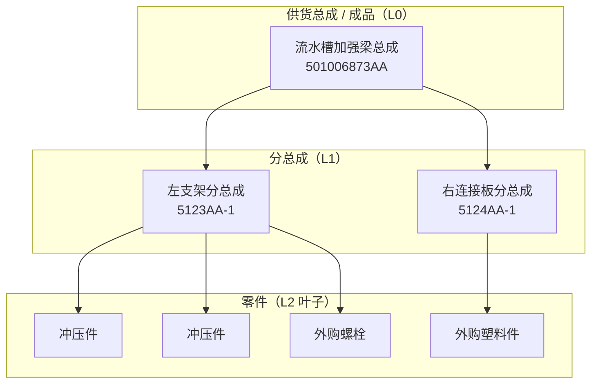
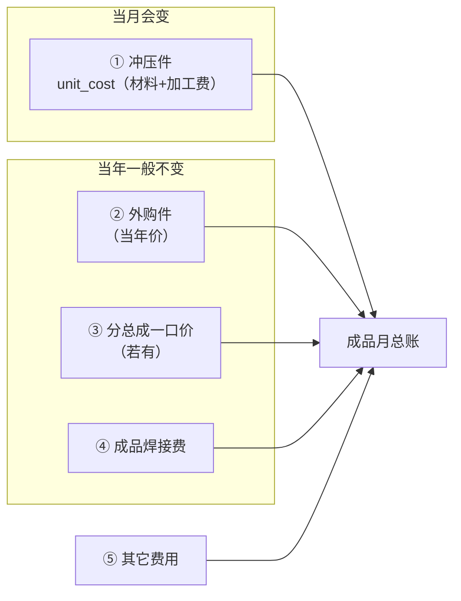
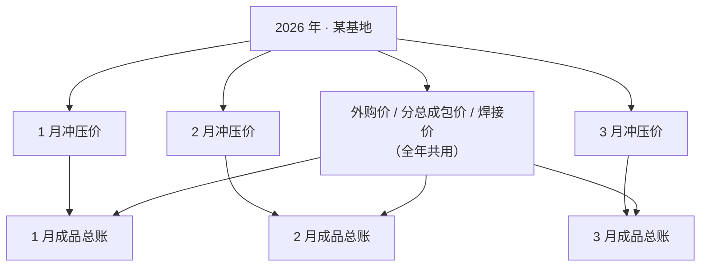
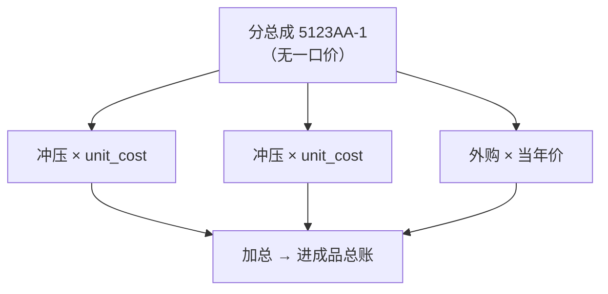
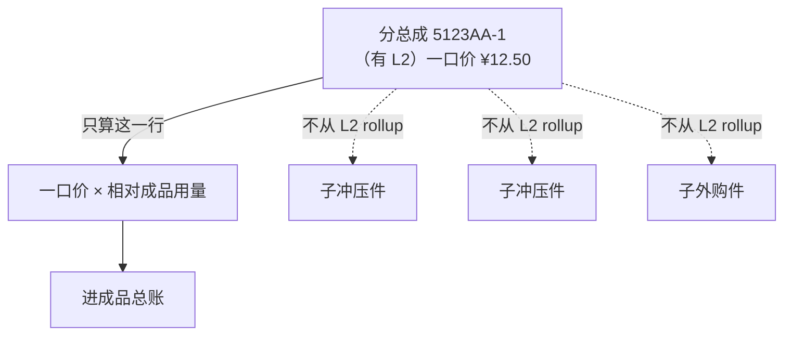
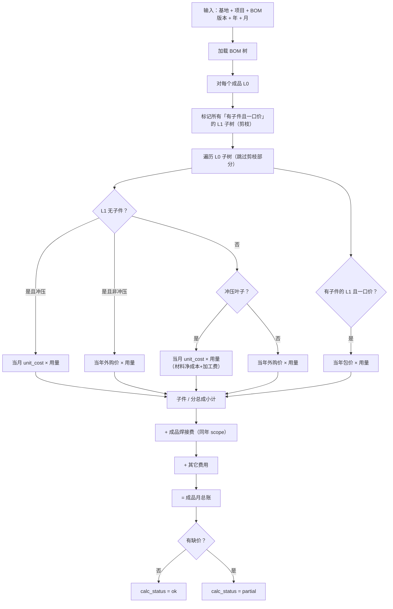

# 供货总成（L0）成品核价 — 业务与设计说明

> 面向业务、实施与新同事。说明 **如何从 BOM 结构算出每个成品的月度总成本**。  
> 本文是设计文档（待落地），与现网已实现的「冲压零件价」「L0 焊接费」等模块衔接。  
> 硬约束（分层、切片依赖）见 [architecture.md](architecture.md)。

---

## 1. 一句话说明

**每个「供货总成（成品）」每月算一笔总账**：当月冲压件 + 当年外购件 + 分总成一口价（若有）+ 成品焊接费 + 其它费用。

> **一口价的分总成**：L1 **必须有子节点**；BOM 里仍能看到 L2，但核价时 **只认 L1 包价**，**不从 L2 rollup**。

---

## 2. 名词对照（先看这个）

| 对外说法（推荐） | 内部代号 | 含义 |
|------------------|----------|------|
| 供货总成 / **成品** | L0 | 交付客户的冲焊装配单元，核价与报价的主单位 |
| **分总成** | L1（**必须有子节点**） | 成品下还有 L2 的焊接结构；才可能一口价 |
| **零件** | L2 叶子，或 **无子节点的 L1** | 最底层：冲压件或外购件 |
| 按子件加总 | 拆散 | **有子节点** 的 L1 **无一口价**时，才对 L2 分别计价 |
| 分总成一口价 | 包价 | L1 有子节点且有价表记录：**不从 L2 rollup**，只用包价 |
| 未算齐 | partial | 缺冲压价、缺外购价等，总成金额不完整 |

---

## 3. 我们算的是谁？（结构）



- 结构数据来自现有 **BOM 材料清单**（`bom_snapshots` + `bom_nodes`）。
- 用量：子件相对父件有 `qty`；相对 **成品** 的有效用量 = 从 L0 到该节点路径上各层 `qty` **连乘**。

---

## 4. 成品月总账 = 五块积木



| 分项 | 价从哪来 | 更新频率 | 现网状态 |
|------|----------|----------|----------|
| ① 冲压件 | **钢材联动（材料净成本）+ 冲压加工费** → 单件成本 `unit_cost` | **每月** | ✅ 已有 `stamping_part_costs`（已完成，成品核价只读复用） |
| ② 外购件 | 基地 + 年度 + 零件号 | **每年**（按基地） | ⏳ 待建 **`bom_annual_part_prices`**（与③同表） |
| ③ 分总成一口价 | 基地 + 年度 + L1 零件号 | **每年**（按基地） | ⏳ 同上；命中且 L1 有子件 → 包价剪枝 |
| ④ 成品焊接费 | 工序单价 × L0 过程量 | **每年**算结果 | ✅ 已有 `bom_l0_welding_fees` |
| ⑤ 其它费用 | 手工或导入 | 按需 | ✅ L0 焊接费表已有 `other_fee` 字段可参考 |

**① 冲压件取价（与现网一致，勿拆开重算）：**

```text
stamping_part_costs.unit_cost
  = material_net_per_part   ← 钢价联动（含废料扣除后的原材料净成本 R）
  + process_fee_amount      ← 冲压加工费（元/件）
```

成品月总账对每个冲压叶子：**`unit_cost × 相对成品有效用量`**。  
不再在成品核价里单独再算一遍钢价或加工费。

**业务规则（建议写死）：**

- 成品核价 scope：**年 + 月 + 基地 + 项目 + BOM 版本 + 成品零件号**。
- **不认 `stamping_supplier`（冲压工厂）**：成品总账与冲压取价均 **不按工厂筛选 / 不写入工厂维度**。匹配 `stamping_part_costs` 时用 **年 + 月 + 基地 + 项目 + 零件号**（工艺 `version` 与 BOM `bom_version` 可能不一致时按零件号回退匹配，对不齐则 partial）。
- 同一成品在同年 **1～12 月**，通常只有 **① 冲压** 随月份变化；②③④ 用 **同一年、同一基地** 的主数据。
- **不跨基地取价**：青岛缺价不能用芜湖的价顶替。

---

## 5. 时间与粒度（消除「按月核价、价表按年」的疑惑）



| 对象 | 粒度 |
|------|------|
| **成品核价结果** | **月** |
| 冲压零件价 | 月 |
| 外购年度价、L1 包价、焊接工序单价 | 年（按基地） |
| L0 焊接费结果 | 年 + 项目 + BOM 版本（计入各月成品时可复用同年结果） |

---

## 6. 分总成：两种计价（核心）

### 6.1 拆散计价（默认）

无包价记录，或显式标记为「展开」时：分总成本身不产生材料行，**继续向下**，冲压 / 外购叶子分别取价并加总。



### 6.2 一口价（有包价）

前提：**该 L1 在 BOM 上必须有子节点**；且存在 **基地 + 年 + L1 零件号** 的一口价记录。



**规则：**

- 进一口价表 / 命中一口价的 L1：**必须有子节点**（无子节点不得按一口价处理）。
- 行金额 = `bundle_unit_price × effective_qty(L1)`。
- **成本计算不从 L2 rollup**：该 L1 下所有子孙不参与冲压 / 外购加总。
- BOM 结构树仍可展示 L2；**钱只认 L1 一口价**。

**默认策略：** 有子节点的 L1 无一口价记录 → **才对 L2 拆散计价**；一口价需 **显式维护** 后才生效。  
**L1 无子节点：** 不是分总成。非冲压 → **外购**；冲压 → 走当月冲压价。

---

## 7. 外购件是什么？（清单定义）


**节点分类（写死）：**

| BOM 节点 | 归类 | 取价 |
|----------|------|------|
| L0 | 成品容器 | 不单独计材料；加焊接费等 |
| L1 **有子节点** | 分总成 | 有一口价 → **不从 L2 rollup**，只用包价；无一口价 → 才对 L2 拆散 |
| L1 **无子节点** + **是**冲压件 | 冲压叶子 | 当月 `unit_cost` |
| L1 **无子节点** + **不是**冲压件 | **外购叶子** | 当年 `bom_annual_part_prices` |
| L2 冲压 / 外购 | 叶子 | 同上 |

**冲压件判定（满足任一即可）：**

- `node_role = make`
- 制造类别为 `stamping`
- 在该月冲压零件价表中能命中该零件号

**外购件类别：** 标准件、塑料、橡胶、辅料、其它外购等（`buy` / `standard` / `plastic` / `rubber` / `consumable` / `other`）。  
**含：** 挂在一级、下面没有二级、且未判为冲压的零件。

**注意：** 外购价表的 **单位**（`pcs` / `mm`）须与 BOM 用量单位一致。

---

## 8. 计算流程（对每个成品、每个年月）



**成品月总账公式：**

```text
total = stamping_amount + purchased_amount + sub_assembly_bundle_amount
      + welding_amount + other_fee
```

**防双计：**

| 规则 | 说明 |
|------|------|
| 焊接费只挂 L0 | 不按子件再加焊接 |
| 一口价 L1 截断子树 | **必须有子节点**；命中后 **不从 L2 rollup** |
| 拆散 L1 | **有子节点** 且无一口价：才对 L2 分别计价 |
| L1 无子节点非冲压 | **外购**，禁止当一口价 |

---

## 9. 逻辑表结构（待落地）

### 9.1 已有（直接复用）

| 逻辑表 | 作用 |
|--------|------|
| `bom_snapshots` / `bom_nodes` | BOM 结构与用量 |
| `stamping_part_costs` | 冲压件 **月度** 单件成本（`unit_cost` = 钢价联动材料净成本 + 加工费；**已完成，只读复用**） |
| `steel_prices` / 加工费结果等 | ① 的上游；成品核价 **不直接**依赖，只读 `stamping_part_costs` |
| `bom_welding_unit_price` | 焊接 **工序** 年度单价 |
| `bom_l0_welding_fees` | 成品 **焊接费** 年度结果 |

### 9.2 待建 — 年度主数据（按基地）

**`bom_annual_part_prices`（BOM 年度零件价 — 外购与 L1 一口价合并）**

| 字段 | 说明 |
|------|------|
| `location`, `year`, `part_number` | 唯一键（**无车型**） |
| `unit`, `unit_price` | 单位、单价（外购与一口价共用） |
| `supply_type` | 原供货类型原文（沿用 / 标准件 / 胶块 / 分总成…） |
| `audit_status` + 审核字段 | 与焊接单价同规 |

**唯一约束：** `(location, year, part_number)`  
**核价语义：** 价表只存价；L1 有子件且命中 → 一口价剪枝；叶子命中 → 外购。详见 [bom-annual-part-prices-design.md](bom-annual-part-prices-design.md)。

### 9.3 待建 — 成品 **月度** 核价结果

**`costing_l0_assembly_costs`（主表，一行 = 一个成品一个月）**

| 字段 | 说明 |
|------|------|
| `year`, `month`, `location`, `vehicle_model`, `bom_version`, `part_number` | scope |
| `stamping_amount` | ① 小计（Σ `unit_cost × effective_qty`，含材料+加工费） |
| `purchased_amount` | ② 小计 |
| `sub_assembly_bundle_amount` | ③ 小计 |
| `welding_amount` | ④ 引用 `bom_l0_welding_fees` |
| `other_fee` | ⑤ |
| `total_amount` | 合计 |
| `calc_status`, `missing_*_count` | ok / partial |
| `audit_status` | 可选审核 |

**唯一约束：** `(year, month, location, vehicle_model, bom_version, part_number)`

**`costing_l0_assembly_cost_items`（明细，建议有）**

每个参与计价的 BOM 节点一行：`cost_source`（stamping / purchased / sub_assembly_bundle / skipped_by_bundle）、`effective_qty`、`unit_price`、`line_amount`、`match_status`。用于对账与缺价定位。

### 9.4 可选 — 导入溯源

**`bom_part_price_import_batches`**：每次 Excel 导入一批，归档源文件路径与 hash；价表行指向批次 + `excel_row`。**不参与计算公式**，仅防扯皮。

主数据维护建议 **Excel 上传为主**（大表不在网页里行内编辑），列表只读 + 审核 + 导出 round-trip。

---

## 10. 与现网 L0 焊接费的分工

| | L0 焊接费（已实现） | 成品月核价（本文） |
|--|---------------------|---------------------|
| 算什么 | 仅焊接工序费 | **成品全成本** |
| 粒度 | 年 + 基地 + 项目 + BOM 版本 | 上述 + **月** |
| 明细 | 工艺 token 行 | BOM 子件 / 包价行 |
| 关系 | `welding_amount` **引用**其 `final_l0_welding_fee` | 汇总主表 |

两模块并存：焊接费可单独算、单独审；成品核价将其作为分项之一。

---

## 11. 上游依赖与推荐实施顺序

```text
1. BOM 材料清单入库
2. 冲压工艺 + 钢价联动 + 加工费 → 月度冲压零件价（✅ 现网已完成）
3. 年度零件价 `bom_annual_part_prices`（一套 Excel，按基地 + 年；含外购与一口价） ← 待建
4. 焊接工艺拆解 + L0 焊接费（按基地 + 年）              ← 现网已有
5. 成品月核价（编排 ①～⑤，① 只读 unit_cost）            ← 待建
```

缺任一步，对应分项 partial，成品 `calc_status = partial`（与现网 L0 焊接费「缺单价」同一思路）。  
① 缺价 = 该月 `stamping_part_costs` 无匹配行或 `calc_status != success` / 未审核策略待定。

---

## 12. 边界与前提（避免误解）

|  topic | 说明 |
|--------|------|
| 年度价 12 个月不变 | 外购 / L1 / 焊接价表无「生效月」时，同年各月共用；年中改价需重导并重算历史月（若需要） |
| 一口价 vs BOM 子件 | 结构参考保留；核价以价表包价为准 |
| 同号多分支 | 同一零件号在同一成品不同分支出现时，分别 rollup 后 **相加** |
| BOM 版本 vs 工艺版本 | 与现网冲压/BOM 一致：按零件号 + 基地 + 项目匹配，版本可能对不齐 → partial |
| **不认冲压工厂** | 成品核价 **忽略** `stamping_supplier`。上游表虽按工厂存价，成品侧不选工厂、结果表也不存工厂。同零件号多工厂多条价时：优先已审核行；若多条 `unit_cost` 不一致，记 warning / partial（实现时再定细则），**不以工厂维度拆开成品总账** |
| 分类歧义 | 同一节点只能走一条路径。**L1 无子件且非冲压 = 外购**；有子件才可能一口价。冲压优先于外购（make / 命中冲压价表） |
| 勿重复计加工费 | ① 已含加工费；④ 仅为 **成品焊接费**，不是冲压加工费 |

---

## 13. 切片归属（实现时）

| 内容 | 切片 |
|------|------|
| 外购 / L1 年度价主数据 | `bom`（单表 `bom_annual_part_prices`，类比焊接单价） |
| 成品月核价编排与结果 | `costing`（下游，组合 `bom` + `stamping`） |
| 制造类别 / 节点角色 | `app/common/bom/manufacturing_category.py`（已有） |

依赖方向：**costing → bom / stamping**，禁止反向。

---

## 14. 相关文档

| 文档 | 说明 |
|------|------|
| [architecture.md](architecture.md) | 分层与切片 |
| [api-type-safety.md](api-type-safety.md) | API / 金额 Decimal 约定 |
| [bom-annual-part-prices-design.md](bom-annual-part-prices-design.md) | 年度零件价单表（外购+一口价合并） |
| `app/models/costing/stamping_part_cost.py` | 现网冲压零件价（`unit_cost` / 材料净成本 / 加工费） |
| `app/models/bom/node.py` | BOM 节点与 `node_role` 注释 |
| `app/common/bom/manufacturing_category.py` | 制造类别规则 |
| `app/models/bom/l0_welding_fee.py` | 现网 L0 焊接费结果 |

---

## 修订记录

| 日期 | 说明 |
|------|------|
| 2026-08-19 | 初稿：成品月核价、五块积木、L1 包价不 rollup、表结构逻辑、示意图 |
| 2026-08-20 | 校对冲压分项：明确取 `unit_cost`（钢价联动材料净成本+加工费）、修正流程图「材料小计」误称 |
| 2026-08-20 | 定稿：成品核价 **不认** `stamping_supplier`，取价忽略冲压工厂维度 |
| 2026-08-20 | 明确：L1 无子件且非冲压 = 外购；一口价仅限有子件的 L1 |
| 2026-08-20 | 加硬：一口价 L1 **必须有子节点**；成本计算 **不从 L2 rollup** |
| 2026-08-20 | 外购与 L1 一口价 **合并为单表** `bom_annual_part_prices` |
